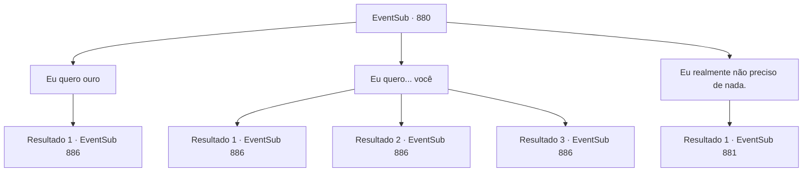

# Eventos secundários · 880

[Índice da tabela](index.md) · [Índice geral](../index.md)

ID: `pt:EventSub:880` · Fonte: `EventSub4` · Versão: 1.2.47.

Mapeamento estático dos arquivos; a disponibilidade e a execução dependem do estado da run.

## Texto do evento

*Sem texto no arquivo.*

## Dados de entrada

```json
{
  "id": 880,
  "grade": 1,
  "subEvent": "",
  "required": ""
}
```

## Mapa das escolhas



## Escolhas e resultados

### Escolha 1

Eu quero ouro

Requisitos e outros campos da escolha:

```json
{
  "required": ""
}
```

#### Resultado 1.1

Sua resposta deve ter desapontado Shao. 

 "...Huh. Tudo bem."

 Ela remexe nos bolsos e tira uma bolsa cheia de ouro, depois sai como o vento. Você não presta atenção e aluga um quarto em uma pousada local. Lá, você se deita na cama para dar ao seu corpo um descanso muito necessário. O calor do festival começa a diminuir também. 

 É cedo de manhã. Você se prepara para sair da pousada. Quando está prestes a sair da pousada, o dono da pousada te para. 

 "Ei. Alguém deixou uma carta para você."


Continuação registrada: [Evento 886](0886.md) na mesma tabela.

```json
{
  "required": "",
  "chance": "1",
  "nextEvent": 886,
  "type": 2,
  "reward": "0_4_200|14_11_16"
}
```

### Escolha 2

Eu quero... você

Requisitos e outros campos da escolha:

```json
{
  "required": "24_1_1"
}
```

#### Resultado 2.1

Shao cora imediatamente, mas faz o melhor para esconder seus sentimentos, olhando nos seus olhos com um sorriso relaxado. 

 "T- tudo bem! Um acordo é um acordo... Eu - eu terei que notificar o Chefe do Clã e os anciãos também! Faremos o casamento no meu lugar. Afinal, eu vou me tornar a próxima Chefe do Clã."

 Ela tira um amuleto de jade, com a imagem de um dragão oriental desenhada nele. 

 "Esse é um Amuleto do Dragão. Apenas concedido àqueles a quem meu clã deve uma grande dívida. Você vem ao meu clã com esse amuleto, e será tratado com a máxima hospitalidade."

 Você não pode deixar de pegar o amuleto de jade. Então, Shao te puxa para um abraço. Um doce perfume de lótus invade seu nariz. 

 "Certifique-se de vir até mim, assim que sua aventura terminar. Eu - eu estarei... esperando..."

 Você pega sua recompensa e consegue um quarto em uma pousada local. Lá, você se deita na cama para dar ao seu corpo um descanso muito necessário. O calor do festival começa a diminuir também. 

 É cedo de manhã. Você se prepara para sair da pousada. Assim que está prestes a sair da pousada, o dono da pousada te para. 

 "Ei, alguém deixou uma carta para você."


Continuação registrada: [Evento 886](0886.md) na mesma tabela.

```json
{
  "required": "11_0_0",
  "chance": "1|0_12_1",
  "nextEvent": 886,
  "type": 0,
  "reward": "3_326_1|14_11_18|5_761_1|29_11_1"
}
```

#### Resultado 2.2

Shao cora imediatamente, mas faz o melhor para esconder seus sentimentos, olhando nos seus olhos com um sorriso relaxado. 

 "T- tudo bem! Um acordo é um acordo... Eu - eu terei que notificar o Chefe do Clã e os anciãos também! Faremos o casamento no meu lugar. Afinal, eu vou me tornar a próxima Chefe do Clã."

 Ela tira um amuleto de jade, com a imagem de um dragão oriental desenhada nele. 

 "Esse é um Amuleto do Dragão. Apenas concedido àqueles a quem meu clã deve uma grande dívida. Você vem ao meu clã com esse amuleto, e será tratado com a máxima hospitalidade."

 Você não pode deixar de pegar o amuleto de jade. Então, Shao te puxa para um abraço. Um doce perfume de lótus invade seu nariz. 

 "Certifique-se de vir até mim, assim que sua aventura terminar. Eu - eu estarei... esperando..."

 Você pega sua recompensa e consegue um quarto em uma pousada local. Lá, você se deita na cama para dar ao seu corpo um descanso muito necessário. O calor do festival começa a diminuir também. 

 É cedo de manhã. Você se prepara para sair da pousada. Assim que está prestes a sair da pousada, o dono da pousada te para. 

 "Ei, alguém deixou uma carta para você."


Continuação registrada: [Evento 886](0886.md) na mesma tabela.

```json
{
  "required": "11_0_1",
  "chance": "1|0_12_1",
  "nextEvent": 886,
  "type": 0,
  "reward": "3_326_1|14_11_14|5_761_1"
}
```

#### Resultado 2.3

O rosto de Shao escurece. Ela evita mais contato visual com você. 

 "Isso... Eu não posso fazer isso. Você é... um estrangeiro. Sinto muito, mas... espero que isso seja suficiente."

 Ela tira um amuleto de jade, com a imagem de um dragão oriental desenhada nele. 

 "Isso é um Amuleto do Dragão. Apenas concedido àqueles a quem meu clã deve uma grande dívida. Você vem ao meu clã com esse amuleto, e será tratado com a máxima hospitalidade."

 Ela lhe entrega o amuleto de jade e sai como o vento. Você pega sua recompensa e consegue um quarto em uma pousada local. Lá, você se deita na cama para dar ao seu corpo um descanso muito necessário. O calor do festival começa a diminuir também. 

 É de manhã cedo. Você se prepara para sair da pousada. Assim que está prestes a sair da pousada, o dono da pousada o para. 

 "Ei, alguém deixou uma carta para você."


Continuação registrada: [Evento 886](0886.md) na mesma tabela.

```json
{
  "required": "",
  "chance": "10",
  "nextEvent": 886,
  "type": 1,
  "reward": "3_326_1|14_11_16"
}
```

### Escolha 3

Eu realmente não preciso de nada.

Requisitos e outros campos da escolha:

```json
{
  "required": ""
}
```

#### Resultado 3.1


 "Pare de fingir humildade e pense. Será que realmente não há nada que você deseja?"

 Shao te pergunta mais uma vez, como se estivesse te interrogando. De alguma forma, você percebe que ela está sorrindo. Depois de olhar fixamente em seus olhos por mais alguns segundos, Shao limpa a garganta e faz uma sugestão. 

 "Ahem... Que tal isso, então? Você... vai me acompanhar de volta à minha casa no Oriente. Venha comigo... e eu farei valer a pena."

 Depois de te dizer para pensar com cuidado, ela olha em seus olhos. Você percebe um toque de expectativa nos olhos dela. É como se um feixe de estrelas estivesse emanando deles.

Continuação registrada: [Evento 881](0881.md) na mesma tabela.

```json
{
  "required": "",
  "chance": "1",
  "nextEvent": 881,
  "type": 2,
  "reward": ""
}
```

## Referências que chegam a este evento

- [Evento 879 · escolha 1 · resultado 1](0879.md#escolha-1)
