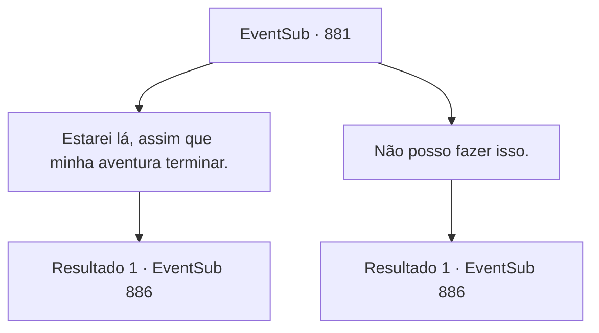

# Eventos secundários · 881

[Índice da tabela](index.md) · [Índice geral](../index.md)

ID: `pt:EventSub:881` · Fonte: `EventSub4` · Versão: 1.2.47.

Mapeamento estático dos arquivos; a disponibilidade e a execução dependem do estado da run.

## Texto do evento

*Sem texto no arquivo.*

## Dados de entrada

```json
{
  "id": 881,
  "grade": 1,
  "subEvent": "",
  "required": ""
}
```

## Mapa das escolhas



## Escolhas e resultados

### Escolha 1

Estarei lá, assim que minha aventura terminar.

Requisitos e outros campos da escolha:

```json
{
  "required": "24_1_1"
}
```

#### Resultado 1.1

Você diz a ela que estará lá depois que terminar sua aventura. Shao sorri, satisfeita. Ela tira um amuleto de jade, com a imagem de um dragão oriental desenhada nele. 

 "Esse é um Amuleto do Dragão. Apenas concedido àqueles a quem meu clã deve uma grande dívida. Você vem ao meu clã com esse amuleto, e será tratado com a máxima hospitalidade."

 Você não pode deixar de pegar o amuleto de jade. Então, Shao te puxa para um abraço. Um doce perfume de lótus invade seu nariz. 

 "Certifique-se de vir até mim, assim que sua aventura terminar. Eu- Eu estarei... esperando..."

 O calor do festival começa a diminuir. De madrugada, você se prepara para deixar a pousada. Então, uma carta em sua mesa chama sua atenção. Está apenas ali, esperando que você a abra.

Continuação registrada: [Evento 886](0886.md) na mesma tabela.

```json
{
  "required": "",
  "chance": "1",
  "nextEvent": 886,
  "type": 2,
  "reward": "3_326_1|14_11_14|5_761_1"
}
```

### Escolha 2

Não posso fazer isso.

Requisitos e outros campos da escolha:

```json
{
  "required": ""
}
```

#### Resultado 2.1

Você diz a ela que não pode fazer isso. Sua resposta deve ter desapontado Shao. 

 "...Entendo. Que pena. Então, leve isto, pelo menos. Este é um Amuleto do Dragão. Apenas concedido àqueles a quem meu clã deve uma grande dívida. Você vem ao meu clã com esse amuleto, e será tratado com a máxima hospitalidade."

 Ela lhe entrega o amuleto de jade e sai como o vento. 

 O calor do festival começa a diminuir. De madrugada, você se prepara para deixar a pousada. Então, uma carta em sua mesa chama sua atenção. Está apenas ali, esperando que você a abra.

Continuação registrada: [Evento 886](0886.md) na mesma tabela.

```json
{
  "required": "",
  "chance": "1",
  "nextEvent": 886,
  "type": 2,
  "reward": "3_326_1|14_11_16"
}
```

## Referências que chegam a este evento

- [Evento 880 · escolha 3 · resultado 1](0880.md#escolha-3)
- [Evento 883 · escolha 1 · resultado 1](0883.md#escolha-1)
