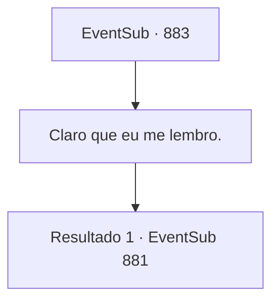

# Eventos secundários · 883

[Índice da tabela](index.md) · [Índice geral](../index.md)

ID: `pt:EventSub:883` · Fonte: `EventSub4` · Versão: 1.2.47.

Mapeamento estático dos arquivos; a disponibilidade e a execução dependem do estado da run.

## Texto do evento

*Sem texto no arquivo.*

## Dados de entrada

```json
{
  "id": 883,
  "grade": 1,
  "subEvent": "",
  "required": ""
}
```

## Mapa das escolhas



## Escolhas e resultados

### Escolha 1

Claro que eu me lembro.

Requisitos e outros campos da escolha:

```json
{
  "required": ""
}
```

#### Resultado 1.1

Ao ouvir sua resposta, Shao sorri amplamente e continua. 

 "Bom. Agora ouça. O que eu quero é..."

 Antes de apresentar sua exigência, Shao limpa a garganta. Ela até endireita suas roupas e organiza seu cabelo. Então, os olhos negros de Shao se fixam nos seus. 

 "Assim que sua aventura terminar, você virá para o meu clã. Eu farei de você minha pessoa de confiança."

 Ela aguarda sua resposta, seus olhos brilhando de expectativa.

Continuação registrada: [Evento 881](0881.md) na mesma tabela.

```json
{
  "required": "",
  "chance": "1",
  "nextEvent": 881,
  "type": 2,
  "reward": ""
}
```

## Referências que chegam a este evento

- [Evento 882 · escolha 1 · resultado 1](0882.md#escolha-1)
