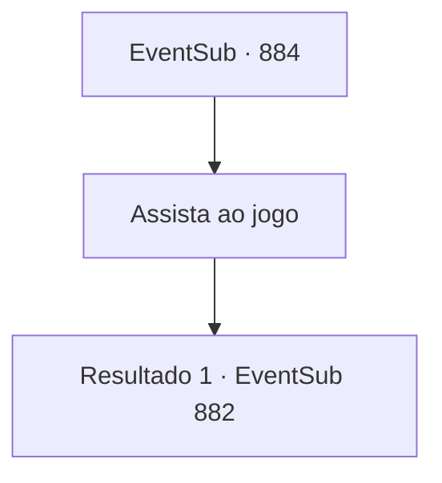

# Eventos secundários · 884

[Índice da tabela](index.md) · [Índice geral](../index.md)

ID: `pt:EventSub:884` · Fonte: `EventSub4` · Versão: 1.2.47.

Mapeamento estático dos arquivos; a disponibilidade e a execução dependem do estado da run.

## Texto do evento

*Sem texto no arquivo.*

## Dados de entrada

```json
{
  "id": 884,
  "grade": 1,
  "subEvent": "",
  "required": ""
}
```

## Mapa das escolhas



## Escolhas e resultados

### Escolha 1

Assista ao jogo

Requisitos e outros campos da escolha:

```json
{
  "required": ""
}
```

#### Resultado 1.1

À medida que a noite chega, a maioria das lutas chega ao fim, e a luta final está prestes a começar. 

 "Lei Ryu do Clã Ryu! E Shao Ryu, do mesmo Clã Ryu!"

 Os dois competidores no palco sacam suas espadas e assumem uma postura semelhante. Eles parecem estar conversando sobre algo, mas você não consegue entender nada da conversa deles, principalmente devido ao barulho da multidão. Logo, a luta começa e um elegante e violento confronto de aço se segue. 

 A luta começa a se arrastar, mas o equilíbrio apertado é quebrado por um único erro. Lei, atacando imprudentemente, baixou a guarda e foi atingido por uma forte riposta. <link=shake>

 "WOOOOOOOOO!!!"

</link> Aplausos estrondosos explodem da multidão. Shao acena com as mãos no ar, respondendo aos aplausos. Lei encara Shao sem expressão por mais alguns segundos antes de lentamente sair da arena.

Continuação registrada: [Evento 882](0882.md) na mesma tabela.

```json
{
  "required": "",
  "chance": "1",
  "nextEvent": 882,
  "type": 2,
  "reward": ""
}
```

## Referências que chegam a este evento

- [Evento 872 · escolha 2 · resultado 1](0872.md#escolha-2)
- [Evento 874 · escolha 2 · resultado 1](0874.md#escolha-2)
