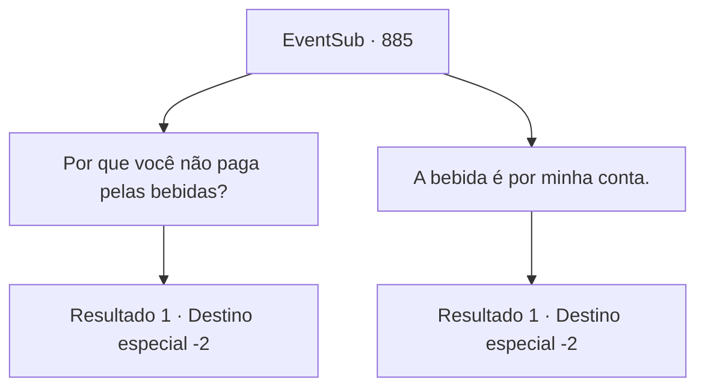

# Eventos secundários · 885

[Índice da tabela](index.md) · [Índice geral](../index.md)

ID: `pt:EventSub:885` · Fonte: `EventSub4` · Versão: 1.2.47.

Mapeamento estático dos arquivos; a disponibilidade e a execução dependem do estado da run.

## Texto do evento

*Sem texto no arquivo.*

## Dados de entrada

```json
{
  "id": 885,
  "grade": 1,
  "subEvent": "",
  "required": ""
}
```

## Mapa das escolhas



## Escolhas e resultados

### Escolha 1

Por que você não paga pelas bebidas?

Requisitos e outros campos da escolha:

```json
{
  "required": ""
}
```

#### Resultado 1.1

Você segue Lei até uma taverna local. Lá, vocês dois se sentam perto das janelas e começam a beber. Vocês trocam histórias de aventuras com Lei e discutem as diferenças culturais entre seu mundo e o Oriente. Isso rende um ótimo tópico para conversa. 

 "Aprendi muito com você, Sohyeop. Agradeço sinceramente, de todo o coração."

 Os elogios de Lei tornam sua bebida ainda mais saborosa. O calor do festival começa a diminuir. O mesmo acontece com a taverna e sua mesa. Lei começa a falar cuidadosamente, seu rosto corando com o efeito do álcool. 

 "... Estou pensando em voltar para o Oriente. Provavelmente nunca mais poderei ver você, Sohyeop. Mas juro que nunca, jamais esquecerei o tempo que passei com você. Desejo-lhe sorte em seus futuros empreendimentos, Sohyeop."

 O silêncio preenche o ar entre você e Lei. Você troca uma última bebida com ele.

Continuação registrada: [Destino especial `-2`](../destinos-especiais.md).

```json
{
  "required": "",
  "chance": "1",
  "nextEvent": -2,
  "type": 2,
  "reward": "0_1_1|14_11_2|14_11_16|12_11_-1"
}
```

### Escolha 2

A bebida é por minha conta.

Requisitos e outros campos da escolha:

```json
{
  "required": "1_4_10"
}
```

#### Resultado 2.1

Você segue Lei até uma taverna local. Lá, vocês dois se sentam perto das janelas e começam a conversar. 

 "Bem, bem. Parece que te devo mais. Obrigado, Sohyeop."

 Lei junta as mãos em gratidão e se senta. Vocês trocam histórias de aventuras com Lei e discutem as diferenças culturais entre seu mundo e o Oriente. Isso rende um ótimo assunto para conversa. 

 "Aprendi muito com você, Sohyeop. Agradeço sinceramente, de todo o coração."

 Os elogios de Lei tornam sua bebida ainda mais saborosa. O calor do festival começa a diminuir. O mesmo acontece com a taverna e sua mesa. Lei começa a falar cuidadosamente, seu rosto corando pelo efeito do álcool. 

 "... Estou pensando em voltar para o Oriente. Provavelmente nunca mais poderei te ver, Sohyeop. Mas juro que nunca, jamais esquecerei o tempo que passei com você. Desejo-lhe sorte em seus futuros empreendimentos, Sohyeop."

 O silêncio preenche o ar entre você e Lei. Você troca uma última bebida com ele.

Continuação registrada: [Destino especial `-2`](../destinos-especiais.md).

```json
{
  "required": "",
  "chance": "1",
  "nextEvent": -2,
  "type": 2,
  "reward": "0_1_1|0_4_-10|14_11_2|14_11_16|12_11_-1"
}
```

## Referências que chegam a este evento

- [Evento 879 · escolha 1 · resultado 2](0879.md#escolha-1)
- [Evento 882 · escolha 1 · resultado 2](0882.md#escolha-1)
