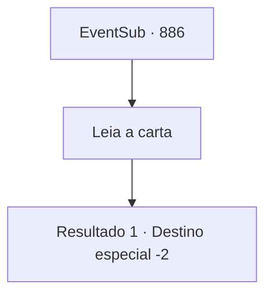

# Eventos secundários · 886

[Índice da tabela](index.md) · [Índice geral](../index.md)

ID: `pt:EventSub:886` · Fonte: `EventSub4` · Versão: 1.2.47.

Mapeamento estático dos arquivos; a disponibilidade e a execução dependem do estado da run.

## Texto do evento

*Sem texto no arquivo.*

## Dados de entrada

```json
{
  "id": 886,
  "grade": 1,
  "subEvent": "",
  "required": ""
}
```

## Mapa das escolhas



## Escolhas e resultados

### Escolha 1

Leia a carta

Requisitos e outros campos da escolha:

```json
{
  "required": ""
}
```

#### Resultado 1.1

A letra cuidadosamente escrita, mas rígida, está escrita na carta. 'Eu não consegui vencer, mas aprendi muito. É tudo graças a você, Sohyeop. Estou a caminho de volta para o Leste. Provavelmente nunca poderei vê-lo novamente. Mas eu juro, nunca, jamais esquecerei o tempo que passei com você. Desejo-lhe sorte em seus futuros empreendimentos. Lei Ryu.' Após ler a carta, você olha brevemente para o Leste e retorna às suas aventuras.

Continuação registrada: [Destino especial `-2`](../destinos-especiais.md).

```json
{
  "required": "",
  "chance": "1",
  "nextEvent": -2,
  "type": 2,
  "reward": "12_11_-1"
}
```

## Referências que chegam a este evento

- [Evento 880 · escolha 1 · resultado 1](0880.md#escolha-1)
- [Evento 880 · escolha 2 · resultado 1](0880.md#escolha-2)
- [Evento 880 · escolha 2 · resultado 2](0880.md#escolha-2)
- [Evento 880 · escolha 2 · resultado 3](0880.md#escolha-2)
- [Evento 881 · escolha 1 · resultado 1](0881.md#escolha-1)
- [Evento 881 · escolha 2 · resultado 1](0881.md#escolha-2)
