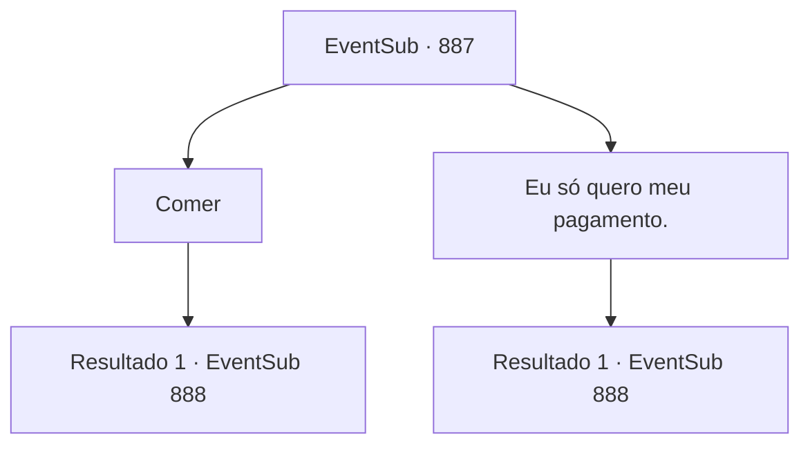

# Eventos secundários · 887

[Índice da tabela](index.md) · [Índice geral](../index.md)

ID: `pt:EventSub:887` · Fonte: `EventSub4` · Versão: 1.2.47.

Mapeamento estático dos arquivos; a disponibilidade e a execução dependem do estado da run.

## Texto do evento

Você chega a Tunaas, para finalmente colocar as mãos no pagamento. Tunaas, graças à sua proximidade com o Grande Deserto, tem um estilo arquitetônico semelhante ao de outros assentamentos do deserto. Tendas coloridas cobrem as ruas, com pequenas barracas e cabines espalhadas aqui e ali, servindo como pequenas lojas. Enquanto você está passeando pelo local, um homem vestindo uma vestimenta oriental se aproxima de você. 

 "{1}? Siga me por favor. A Srta. Shao está esperando."

 Você o segue até um restaurante luxuoso. Shao está no segundo andar, saboreando carneiro assado e vinho de uva. Enquanto você caminha em direção a ela, Shao percebe você e fala, chamando o garçom. 

 "Ah, você está aqui. Desculpe o tempo - você me pegou durante minha refeição."


## Dados de entrada

```json
{
  "id": 887,
  "grade": 1,
  "subEvent": "",
  "required": "12_11_14|1_2_40"
}
```

## Mapa das escolhas



## Escolhas e resultados

### Escolha 1

Comer

Requisitos e outros campos da escolha:

```json
{
  "required": ""
}
```

#### Resultado 1.1

Você é servido com o mesmo prato que Shao está comendo - carneiro assado. Você dá uma mordida, sentindo a fragrância suculenta e o sabor oleoso preencher sua boca. Shao toma um gole de seu copo de vinho de uva e fala. 

 "Antes de eu te pagar, tenho mais um pedido. Se você cumprir este contrato também, eu dobro o pagamento - 400 ouro. O que acha?"

 O contrato dela é assassinar participantes que vão competir no Torneio de Lutadores de Battra. O primeiro alvo de Shao é um homem chamado 'Sanson, o Matador de Trolls'. 

 "Complete bem o contrato, e talvez eu esteja disposta a oferecer algo... mais do que apenas ouro."

 Shao lhe dá um sorriso cativante, olhando em seus olhos.

Continuação registrada: [Evento 888](0888.md) na mesma tabela.

```json
{
  "required": "",
  "chance": "1",
  "nextEvent": 888,
  "type": 2,
  "reward": "0_0_1"
}
```

### Escolha 2

Eu só quero meu pagamento.

Requisitos e outros campos da escolha:

```json
{
  "required": ""
}
```

#### Resultado 2.1

Você pede primeiro o pagamento prometido. Shao franze a testa, mas esconde com um leve sorriso. 

 "Antes de pagar, tenho mais um pedido. Se você cumprir este contrato também, eu dobro o pagamento - 400 ouro. O que acha?"

 O contrato dela é assassinar participantes que vão competir no Torneio de Lutadores de Battra. O primeiro alvo de Shao é um homem chamado 'Sanson, o Matador de Trolls'. 

 "Complete bem o contrato, e talvez eu esteja disposto a oferecer algo... mais do que apenas ouro."

 Shao lhe dá um sorriso cativante, olhando em seus olhos.

Continuação registrada: [Evento 888](0888.md) na mesma tabela.

```json
{
  "required": "",
  "chance": "1",
  "nextEvent": 888,
  "type": 2,
  "reward": ""
}
```

## Referências que chegam a este evento

Nenhum `nextEvent` positivo da mesma tabela aponta para este nó. Isso não prova que seja inacessível: sorteio e estado de história podem selecioná-lo.

