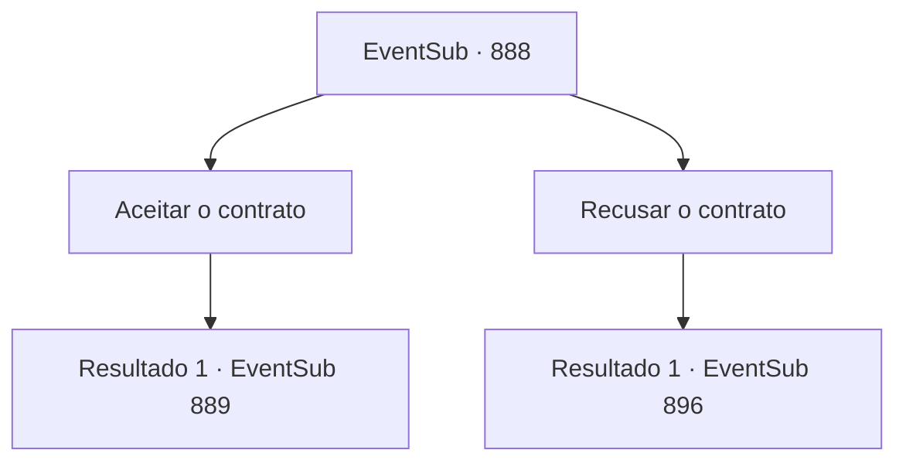

# Eventos secundários · 888

[Índice da tabela](index.md) · [Índice geral](../index.md)

ID: `pt:EventSub:888` · Fonte: `EventSub4` · Versão: 1.2.47.

Mapeamento estático dos arquivos; a disponibilidade e a execução dependem do estado da run.

## Texto do evento

*Sem texto no arquivo.*

## Dados de entrada

```json
{
  "id": 888,
  "grade": 1,
  "subEvent": "",
  "required": ""
}
```

## Mapa das escolhas



## Escolhas e resultados

### Escolha 1

Aceitar o contrato

Requisitos e outros campos da escolha:

```json
{
  "required": ""
}
```

#### Resultado 1.1

Você concorda em aceitar a oferta de Shao. Ela sorri feliz e lhe entrega um pedaço de pergaminho. Nele está desenhado um desenho conciso do rosto de Sanson. 

 "Sanson tem uma reputação infame como alcoólatra. Você o encontrará em uma das tavernas da cidade. Ah, e leve-o sem atrair atenção indesejada."

 Você pega o pergaminho e parte imediatamente para procurar Sanson. Como Shao lhe disse, não foi difícil encontrá-lo. Você entra em uma taverna local e encontra Sanson, bebendo de um barril de carvalho. 

 "Simplesmente incrível! Ele é o Matador de Trolls por uma razão!"

 "Beber tudo isso de uma vez?! Seu estômago é feito de ferro?"

 Ainda nem passou do meio-dia e a taverna já está cheia de risadas e aplausos das pessoas. Você observa cuidadosamente o lugar, procurando uma chance de se aproximar de Sanson.

Continuação registrada: [Evento 889](0889.md) na mesma tabela.

```json
{
  "required": "",
  "chance": "1",
  "nextEvent": 889,
  "type": 2,
  "reward": ""
}
```

### Escolha 2

Recusar o contrato

Requisitos e outros campos da escolha:

```json
{
  "required": ""
}
```

#### Resultado 2.1

Você se recusa a aceitar o novo contrato de Shao e decide aceitar o pagamento. Sem dizer nada, Shao ordena que seus homens tragam um baú cheio de ouro. Dentro do baú há uma pilha de moedas de ouro no valor de cerca de 200 ouro. Quando você está prestes a pegar o baú, uma aura assustadora passa pelo seu pescoço, enviando arrepios pela sua espinha.

Continuação registrada: [Evento 896](0896.md) na mesma tabela.

```json
{
  "required": "",
  "chance": "1",
  "nextEvent": 896,
  "type": 2,
  "reward": ""
}
```

## Referências que chegam a este evento

- [Evento 887 · escolha 1 · resultado 1](0887.md#escolha-1)
- [Evento 887 · escolha 2 · resultado 1](0887.md#escolha-2)
