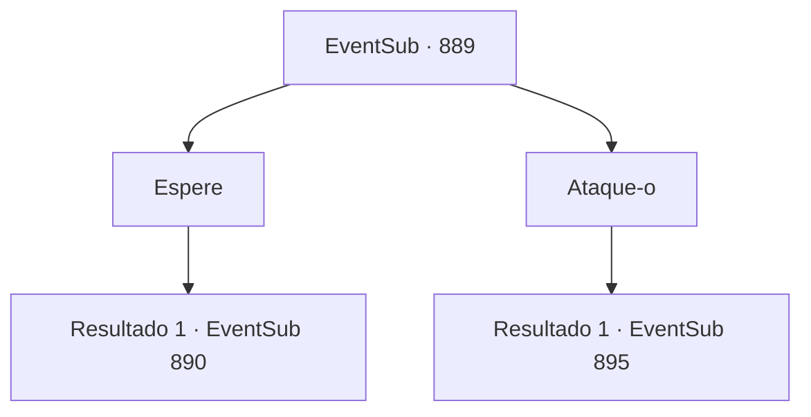

# Eventos secundários · 889

[Índice da tabela](index.md) · [Índice geral](../index.md)

ID: `pt:EventSub:889` · Fonte: `EventSub4` · Versão: 1.2.47.

Mapeamento estático dos arquivos; a disponibilidade e a execução dependem do estado da run.

## Texto do evento

*Sem texto no arquivo.*

## Dados de entrada

```json
{
  "id": 889,
  "grade": 1,
  "subEvent": "",
  "required": ""
}
```

## Mapa das escolhas



## Escolhas e resultados

### Escolha 1

Espere

Requisitos e outros campos da escolha:

```json
{
  "required": ""
}
```

#### Resultado 1.1

Você fica parado e observa Sanson. Fazendo jus à sua reputação, ele só se levanta de seu assento após esvaziar dois barris inteiros de licor. Está lentamente escurecendo lá fora. Você nota Sanson saindo da taverna e o segue para fora. 

 "AQUI VEM SANSON, O MATADOR DE TROLLS! ABRAM CAMINHO~!"

 Sanson bêbado cambaleia pela multidão e entra nas ruas. A direção para onde ele está indo é um beco vazio e sombrio. Você se esconde nas sombras e observa a área. Felizmente, não há ninguém por perto, exceto vocês dois.

Continuação registrada: [Evento 890](0890.md) na mesma tabela.

```json
{
  "required": "",
  "chance": "1",
  "nextEvent": 890,
  "type": 2,
  "reward": ""
}
```

### Escolha 2

Ataque-o

Requisitos e outros campos da escolha:

```json
{
  "required": ""
}
```

#### Resultado 2.1

Você avança em Sanson e o ataca diretamente. Mas seu ataque falha. Como se estivesse esperando por você, Sanson reage habilmente bloqueando você. Ele chuta uma mesa para te parar, então puxa sua arma para lutar. 

 "HÃ?! QUEM É VOCÊ?!"

 Num piscar de olhos, você se torna o defensor, com Sanson vindo em sua direção com força total. O furioso matador de trolls solta um grito de batalha enquanto avança contra você.

Continuação registrada: [Evento 895](0895.md) na mesma tabela.

```json
{
  "required": "",
  "chance": "1",
  "nextEvent": 895,
  "type": 2,
  "reward": "6_0_62",
  "place": 10
}
```

## Referências que chegam a este evento

- [Evento 888 · escolha 1 · resultado 1](0888.md#escolha-1)
