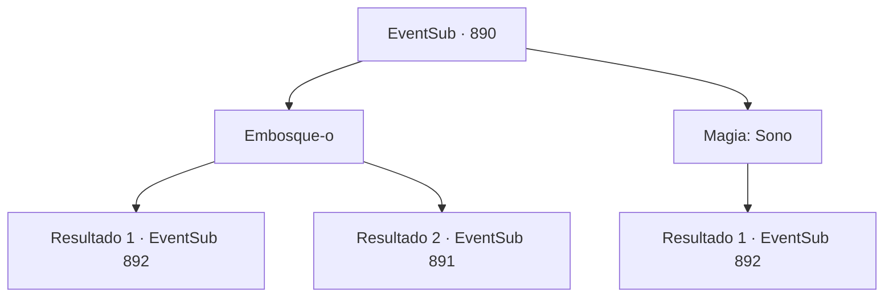

# Eventos secundários · 890

[Índice da tabela](index.md) · [Índice geral](../index.md)

ID: `pt:EventSub:890` · Fonte: `EventSub4` · Versão: 1.2.47.

Mapeamento estático dos arquivos; a disponibilidade e a execução dependem do estado da run.

## Texto do evento

*Sem texto no arquivo.*

## Dados de entrada

```json
{
  "id": 890,
  "grade": 1,
  "subEvent": "",
  "required": ""
}
```

## Mapa das escolhas



## Escolhas e resultados

### Escolha 1

Embosque-o

Requisitos e outros campos da escolha:

```json
{
  "required": ""
}
```

#### Resultado 1.1

Você rapidamente embosca Sanson e tira sua vida. Ele está tão bêbado que nem sabe o que o atingiu. Mas então, você sente alguém atrás de você. Você olha ao redor, apenas para encontrar um grupo familiar de pessoas vindo em sua direção com armas em punho. São os Red Drakes - o grupo de guerreiros do Leste - e seu líder, Shao. 

 "Trabalho esplêndido."

 Shao sorri friamente e fala. Os Red Drakes começam a se aproximar. Eles não deixam você ter saída. O sorriso de Shao se torna ainda mais arrepiante.

Continuação registrada: [Evento 892](0892.md) na mesma tabela.

```json
{
  "required": "",
  "chance": "1|0_6_1",
  "nextEvent": 892,
  "type": 0,
  "reward": ""
}
```

#### Resultado 1.2

Sua emboscada falha. Sanson percebe você assim que você se aproxima dele. Ele está obviamente bêbado, mas seus reflexos ainda estão lá. Ele responde puxando sua arma para lutar. 

 "HÃ?! QUEM É VOCÊ?!"

 Ele grita e a situação se inverte. Num piscar de olhos, você passa a ser o defensor, com Sanson vindo em sua direção com força total. O furioso matador de trolls solta um grito de guerra enquanto avança contra você.

Continuação registrada: [Evento 891](0891.md) na mesma tabela.

```json
{
  "required": "",
  "chance": "13",
  "nextEvent": 891,
  "type": 1,
  "reward": "6_2_62",
  "place": 4
}
```

### Escolha 2

Magia: Sono

Requisitos e outros campos da escolha:

```json
{
  "required": "20_0_1"
}
```

#### Resultado 2.1

Você coloca Sanson para dormir com sua magia e termina sua vida silenciosamente. Ele nem sabe o que o atingiu. Mas então, você sente alguém atrás de você. Você olha ao redor, apenas para encontrar um grupo familiar de pessoas vindo em sua direção com armas em punho. São os Dragões Vermelhos - o grupo de guerreiros do Leste - e seu líder, Shao. 

 "Trabalho esplêndido."

 Shao sorri friamente e fala. Os Dragões Vermelhos começam a se aproximar. Eles não deixam você ter saída.

Continuação registrada: [Evento 892](0892.md) na mesma tabela.

```json
{
  "required": "",
  "chance": "1",
  "nextEvent": 892,
  "type": 2,
  "reward": ""
}
```

## Referências que chegam a este evento

- [Evento 889 · escolha 1 · resultado 1](0889.md#escolha-1)
