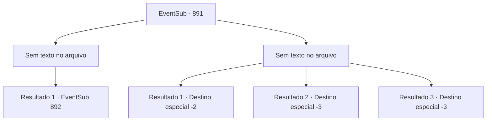

# Eventos secundários · 891

[Índice da tabela](index.md) · [Índice geral](../index.md)

ID: `pt:EventSub:891` · Fonte: `EventSub4` · Versão: 1.2.47.

Mapeamento estático dos arquivos; a disponibilidade e a execução dependem do estado da run.

## Texto do evento

*Sem texto no arquivo.*

## Dados de entrada

```json
{
  "id": 891,
  "grade": 1,
  "subEvent": "",
  "required": ""
}
```

## Mapa das escolhas



## Escolhas e resultados

### Escolha 1

*Sem texto no arquivo; o papel dessa opção depende da interface do jogo.*

Requisitos e outros campos da escolha:

```json
{
  "required": ""
}
```

#### Resultado 1.1

Sanson luta, mas ele não é páreo para você sob a influência. Você acaba com a vida de Sanson e limpa o sangue do seu corpo. Mas então, você sente alguém atrás de você. Você olha ao redor, apenas para encontrar um grupo familiar de pessoas vindo em sua direção com armas em punho. São os Red Drakes - o grupo de guerreiros do Leste - e seu líder, Shao. 

 "Trabalho esplêndido."

 Shao sorri friamente e fala. Os Red Drakes começam a se aproximar. Eles não deixam você ter saída.

Continuação registrada: [Evento 892](0892.md) na mesma tabela.

```json
{
  "required": "",
  "chance": "1",
  "nextEvent": 892,
  "type": 2,
  "reward": ""
}
```

### Escolha 2

*Sem texto no arquivo; o papel dessa opção depende da interface do jogo.*

Requisitos e outros campos da escolha:

```json
{
  "required": ""
}
```

#### Resultado 2.1

Mesmo sob influência, a força brutal de Sanson é uma força a ser reconhecida. Então, um grupo de rostos familiares intervém. São os Dragões Vermelhos do Leste. Sanson também luta contra eles, mas eventualmente cai. Sangue carmesim escorre de seu corpo e cobre o chão. 

 "Trabalho esplêndido."

 Shao sorri friamente e fala. Os Dragões Vermelhos começam a se aproximar. Eles não deixam você ter uma saída.

Continuação registrada: [Destino especial `-2`](../destinos-especiais.md).

```json
{
  "required": "1_0_2|1_1_2",
  "chance": "1",
  "nextEvent": -2,
  "type": 2,
  "reward": "0_0_-1|0_1_-1"
}
```

#### Resultado 2.2

Aparentemente, ele não ganhou o apelido de Matador de Trolls à toa. Mesmo sob influência, a força brutal de Sanson é uma força a ser reconhecida. Seus braços musculosos e grossos começam a te sufocar. Você sente sua consciência se esvaindo.

Continuação registrada: [Destino especial `-3`](../destinos-especiais.md).

```json
{
  "required": "2_0_2",
  "chance": "1",
  "nextEvent": -3,
  "type": 2,
  "reward": "0_0_-1|0_1_-1"
}
```

#### Resultado 2.3

Aparentemente, ele não ganhou o apelido de Matador de Trolls à toa. Mesmo sob influência, a força brutal de Sanson é uma força a ser reconhecida. Seus braços musculosos e grossos começam a te sufocar. Você sente sua consciência se esvaindo.

Continuação registrada: [Destino especial `-3`](../destinos-especiais.md).

```json
{
  "required": "2_1_2",
  "chance": "1",
  "nextEvent": -3,
  "type": 2,
  "reward": "0_0_-1|0_1_-1"
}
```

## Referências que chegam a este evento

- [Evento 890 · escolha 1 · resultado 2](0890.md#escolha-1)
