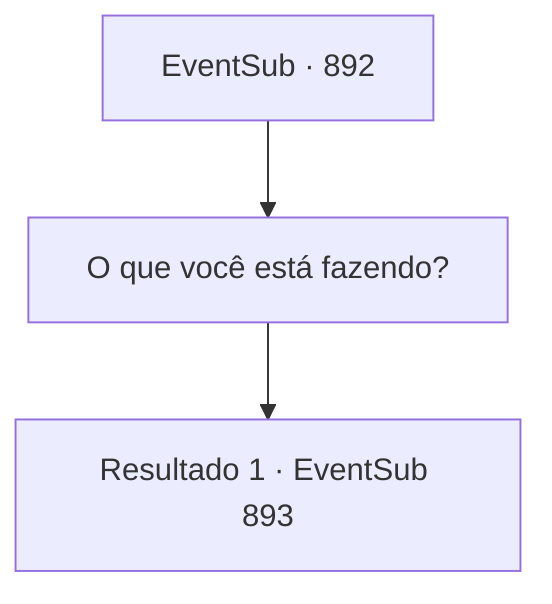

# Eventos secundários · 892

[Índice da tabela](index.md) · [Índice geral](../index.md)

ID: `pt:EventSub:892` · Fonte: `EventSub4` · Versão: 1.2.47.

Mapeamento estático dos arquivos; a disponibilidade e a execução dependem do estado da run.

## Texto do evento

*Sem texto no arquivo.*

## Dados de entrada

```json
{
  "id": 892,
  "grade": 1,
  "subEvent": "",
  "required": ""
}
```

## Mapa das escolhas



## Escolhas e resultados

### Escolha 1

O que você está fazendo?

Requisitos e outros campos da escolha:

```json
{
  "required": ""
}
```

#### Resultado 1.1

Shao responde soltando uma risada de arrepiar os ossos. 

 "Pahaha! Você realmente achou que eu ia deixar você ir, assim tão fácil? Que tolice. Por que eu deixaria um estrangeiro com conhecimento dos negócios do clã ir livremente?"

 Ela olha para você com olhos frios e continua. 

 "Bem, acho que devo agradecer. Você me ajudou a me livrar do filho daquela prostituta imunda... Mas é aqui que sua jornada termina. Dragões Vermelhos! Ataquem!"

 Assim que ela dá a ordem, os guerreiros do Oriente avançam contra você.

Continuação registrada: [Evento 893](0893.md) na mesma tabela.

```json
{
  "required": "",
  "chance": "1",
  "nextEvent": 893,
  "type": 2,
  "reward": "6_3_179",
  "place": 4
}
```

## Referências que chegam a este evento

- [Evento 890 · escolha 1 · resultado 1](0890.md#escolha-1)
- [Evento 890 · escolha 2 · resultado 1](0890.md#escolha-2)
- [Evento 891 · escolha 1 · resultado 1](0891.md#escolha-1)
- [Evento 895 · escolha 1 · resultado 1](0895.md#escolha-1)
- [Evento 895 · escolha 2 · resultado 1](0895.md#escolha-2)
