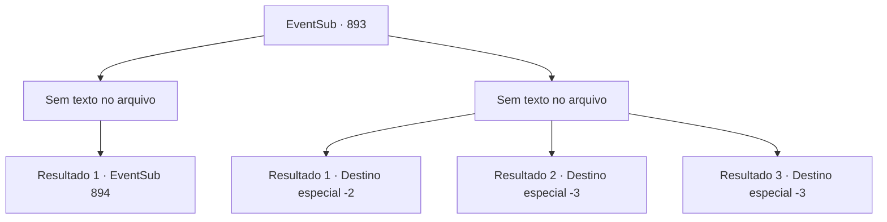

# Eventos secundários · 893

[Índice da tabela](index.md) · [Índice geral](../index.md)

ID: `pt:EventSub:893` · Fonte: `EventSub4` · Versão: 1.2.47.

Mapeamento estático dos arquivos; a disponibilidade e a execução dependem do estado da run.

## Texto do evento

*Sem texto no arquivo.*

## Dados de entrada

```json
{
  "id": 893,
  "grade": 1,
  "subEvent": "",
  "required": ""
}
```

## Mapa das escolhas



## Escolhas e resultados

### Escolha 1

*Sem texto no arquivo; o papel dessa opção depende da interface do jogo.*

Requisitos e outros campos da escolha:

```json
{
  "required": ""
}
```

#### Resultado 1.1


 "IDIOTAS! VOCÊS TINHAM UM TRABALHO! NÃO CONSEGUEM LIDAR COM UMA PESSOA DIREITO?!"

 Shao franze a testa para os Red Drakes derrotados. Ela dá um passo à frente, puxando sua lâmina pálida. 

 "Vocês deveriam se sentir honrados. A herdeira do Clã Ryu está lutando com vocês."

 No momento seguinte, Shao começa seu ataque com um lampejo.

Continuação registrada: [Evento 894](0894.md) na mesma tabela.

```json
{
  "required": "",
  "chance": "1",
  "nextEvent": 894,
  "type": 2,
  "reward": "6_0_183",
  "place": 4
}
```

### Escolha 2

*Sem texto no arquivo; o papel dessa opção depende da interface do jogo.*

Requisitos e outros campos da escolha:

```json
{
  "required": ""
}
```

#### Resultado 2.1

Aço frio perfura sua barriga. Você sente a energia se esvaindo do seu corpo, mas milagrosamente consegue segurar o ferimento e fugir. A perseguição não dura muito. Os guardas locais patrulhando a área aparecem na sua frente com grande timing. 

 "H- HÃ?! Ei! Você está bem? Fique comigo!"

 "VOCÊ AÍ! O QUE VOCÊ FEZ!?"

 Os perseguidores ou esperam que você sangre até a morte, ou não querem arriscar mais lutas, pois desaparecem na escuridão em vez de virem atrás de você. Seja como for, você conseguiu sobreviver.

Continuação registrada: [Destino especial `-2`](../destinos-especiais.md).

```json
{
  "required": "1_0_2|1_1_2",
  "chance": "1",
  "nextEvent": -2,
  "type": 2,
  "reward": "0_0_-1|0_1_-1|12_11_-1"
}
```

#### Resultado 2.2

Aço frio perfura sua barriga. Você sente a energia se esvair do seu corpo. Sangue jorra do seu ferimento. Logo, você perde a consciência e desaba.

Continuação registrada: [Destino especial `-3`](../destinos-especiais.md).

```json
{
  "required": "2_0_2",
  "chance": "1",
  "nextEvent": -3,
  "type": 2,
  "reward": "0_0_-1|0_1_-1"
}
```

#### Resultado 2.3

Aço frio perfura sua barriga. Você sente a energia se esvair do seu corpo. Sangue jorra do seu ferimento. Logo, você perde a consciência e desaba.

Continuação registrada: [Destino especial `-3`](../destinos-especiais.md).

```json
{
  "required": "2_1_2",
  "chance": "1",
  "nextEvent": -3,
  "type": 2,
  "reward": "0_0_-1|0_1_-1"
}
```

## Referências que chegam a este evento

- [Evento 892 · escolha 1 · resultado 1](0892.md#escolha-1)
- [Evento 897 · escolha 1 · resultado 1](0897.md#escolha-1)
- [Evento 897 · escolha 2 · resultado 2](0897.md#escolha-2)
