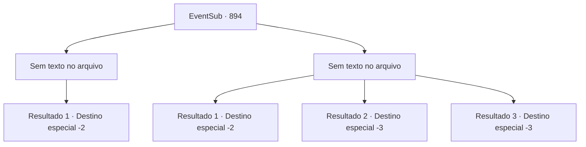

# Eventos secundários · 894

[Índice da tabela](index.md) · [Índice geral](../index.md)

ID: `pt:EventSub:894` · Fonte: `EventSub4` · Versão: 1.2.47.

Mapeamento estático dos arquivos; a disponibilidade e a execução dependem do estado da run.

## Texto do evento

*Sem texto no arquivo.*

## Dados de entrada

```json
{
  "id": 894,
  "grade": 1,
  "subEvent": "",
  "required": ""
}
```

## Mapa das escolhas



## Escolhas e resultados

### Escolha 1

*Sem texto no arquivo; o papel dessa opção depende da interface do jogo.*

Requisitos e outros campos da escolha:

```json
{
  "required": ""
}
```

#### Resultado 1.1

A espada de Shao voa para o ar e depois para o chão. Você se aproxima lentamente de Shao, que está ajoelhada na terra. Com intenção assassina nos olhos, ela te encara. 

 "...Acabe com isso."

 Você atende aos desejos de Shao e saqueia seu corpo. Você pega o ouro de seus bolsos e vai embora.

Continuação registrada: [Destino especial `-2`](../destinos-especiais.md).

```json
{
  "required": "",
  "chance": "1",
  "nextEvent": -2,
  "type": 2,
  "reward": "0_4_400|12_11_-1"
}
```

### Escolha 2

*Sem texto no arquivo; o papel dessa opção depende da interface do jogo.*

Requisitos e outros campos da escolha:

```json
{
  "required": ""
}
```

#### Resultado 2.1

A espada de Shao se move como uma serpente veloz e deixa um corte profundo em seu peito. Você sente a energia se esvair do seu corpo, mas milagrosamente consegue segurar o ferimento e fugir. A perseguição não dura muito. Os guardas locais patrulhando a área aparecem na sua frente com grande timing. 

 "H- HÃ?! Ei! Você está bem? Fique comigo!"

 "VOCÊ AÍ! O QUE VOCÊ FEZ!?"

 Shao decide abandonar a perseguição e desaparece na escuridão. Você conseguiu sobreviver.

Continuação registrada: [Destino especial `-2`](../destinos-especiais.md).

```json
{
  "required": "1_0_2|1_1_2",
  "chance": "1",
  "nextEvent": -2,
  "type": 2,
  "reward": "0_0_-1|0_1_-1|12_11_15"
}
```

#### Resultado 2.2

A espada de Shao se move como uma serpente veloz e deixa um corte profundo em seu peito. O sangue jorra da ferida enquanto você sente a energia se esvair do seu corpo. Olhando para você com um sorriso frio, Shao desfere um último golpe. Infelizmente, seu fim chega com um lampejo.

Continuação registrada: [Destino especial `-3`](../destinos-especiais.md).

```json
{
  "required": "2_0_2",
  "chance": "1",
  "nextEvent": -3,
  "type": 2,
  "reward": "0_0_-1|0_1_-1"
}
```

#### Resultado 2.3

A espada de Shao se move como uma serpente veloz e deixa um corte profundo em seu peito. O sangue jorra da ferida enquanto você sente a energia se esvair do seu corpo. Olhando para você com um sorriso frio, Shao desfere um último golpe. Infelizmente, seu fim chega com um lampejo.

Continuação registrada: [Destino especial `-3`](../destinos-especiais.md).

```json
{
  "required": "2_1_2",
  "chance": "1",
  "nextEvent": -3,
  "type": 2,
  "reward": "0_0_-1|0_1_-1"
}
```

## Referências que chegam a este evento

- [Evento 893 · escolha 1 · resultado 1](0893.md#escolha-1)
