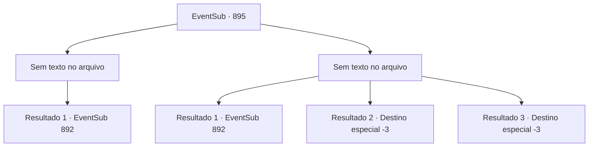

# Eventos secundários · 895

[Índice da tabela](index.md) · [Índice geral](../index.md)

ID: `pt:EventSub:895` · Fonte: `EventSub4` · Versão: 1.2.47.

Mapeamento estático dos arquivos; a disponibilidade e a execução dependem do estado da run.

## Texto do evento

*Sem texto no arquivo.*

## Dados de entrada

```json
{
  "id": 895,
  "grade": 1,
  "subEvent": "",
  "required": ""
}
```

## Mapa das escolhas



## Escolhas e resultados

### Escolha 1

*Sem texto no arquivo; o papel dessa opção depende da interface do jogo.*

Requisitos e outros campos da escolha:

```json
{
  "required": ""
}
```

#### Resultado 1.1

Você consegue derrotar Sanson, mas devido à intervenção dos guardas locais, não consegue tirar sua vida. Infelizmente, você não tem escolha a não ser partir sem completar seu contrato. Você continua fugindo dos perseguidores e eventualmente chega a um beco sombrio. Mas não é hora de relaxar - você sente alguém atrás de você. Você olha para trás e encontra um grupo de rostos familiares se aproximando com armas em punho. São os Dragões Vermelhos, os guerreiros do Leste, e seu líder, Shao Ryu. 

 "Agora, isso não é uma grande decepção."

 Shao exclama de forma condescendente, olhando para você de cima. Os Dragões Vermelhos começam a se aproximar de você, não deixando saída. Em seu rosto há um sorriso frio e amargo.

Continuação registrada: [Evento 892](0892.md) na mesma tabela.

```json
{
  "required": "",
  "chance": "1",
  "nextEvent": 892,
  "type": 2,
  "reward": ""
}
```

### Escolha 2

*Sem texto no arquivo; o papel dessa opção depende da interface do jogo.*

Requisitos e outros campos da escolha:

```json
{
  "required": ""
}
```

#### Resultado 2.1

Sanson te derrota em batalha e começa a te pisotear repetidamente. Mas ele logo é contido pelos guardas locais. Você mal consegue escapar com vida. Infelizmente, você não tem escolha a não ser partir sem completar seu contrato. Você continua fugindo dos perseguidores e eventualmente chega a um beco sombrio. Mas não é hora de relaxar - você sente alguém atrás de você. Você olha para trás e vê um grupo de rostos familiares se aproximando com armas em punho. São os Dragões Vermelhos, os guerreiros do Leste, e seu líder, Shao Ryu. 

 "Agora, isso não é uma grande decepção."

 Shao exclama de forma condescendente, olhando para você de cima. Os Dragões Vermelhos começam a se aproximar de você, não deixando saída. Em seu rosto há um sorriso frio e amargo.

Continuação registrada: [Evento 892](0892.md) na mesma tabela.

```json
{
  "required": "1_0_2|1_1_2",
  "chance": "1",
  "nextEvent": 892,
  "type": 2,
  "reward": "0_0_-1|0_1_-1"
}
```

#### Resultado 2.2

Aço frio perfura sua barriga. Você sente a energia se esvair do seu corpo. Sangue jorra do seu ferimento. Logo, você perde a consciência e desaba.

Continuação registrada: [Destino especial `-3`](../destinos-especiais.md).

```json
{
  "required": "2_0_2",
  "chance": "1",
  "nextEvent": -3,
  "type": 2,
  "reward": "0_0_-1|0_1_-1"
}
```

#### Resultado 2.3

Aço frio perfura sua barriga. Você sente a energia se esvair do seu corpo. Sangue jorra do seu ferimento. Logo, você perde a consciência e desaba.

Continuação registrada: [Destino especial `-3`](../destinos-especiais.md).

```json
{
  "required": "2_1_2",
  "chance": "1",
  "nextEvent": -3,
  "type": 2,
  "reward": "0_0_-1|0_1_-1"
}
```

## Referências que chegam a este evento

- [Evento 889 · escolha 2 · resultado 1](0889.md#escolha-2)
