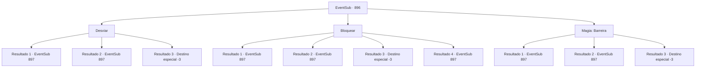

# Eventos secundários · 896

[Índice da tabela](index.md) · [Índice geral](../index.md)

ID: `pt:EventSub:896` · Fonte: `EventSub4` · Versão: 1.2.47.

Mapeamento estático dos arquivos; a disponibilidade e a execução dependem do estado da run.

## Texto do evento

*Sem texto no arquivo.*

## Dados de entrada

```json
{
  "id": 896,
  "grade": 1,
  "subEvent": "",
  "required": ""
}
```

## Mapa das escolhas



## Escolhas e resultados

### Escolha 1

Desviar 

Requisitos e outros campos da escolha:

```json
{
  "required": ""
}
```

#### Resultado 1.1

Então, alguém desce do teto e te ataca. Você rapidamente desvia do ataque e verifica a identidade do atacante. É um dos Red Drakes. Sua emboscada falhou, o guerreiro abaixa a cabeça para Shao como um pedido de desculpas e recua. 

 "Parece que você ainda está atento."

 Shao murmura para si mesma, claramente insatisfeita com o desenrolar dos acontecimentos.

Continuação registrada: [Evento 897](0897.md) na mesma tabela.

```json
{
  "required": "",
  "chance": "1|0_6_1",
  "nextEvent": 897,
  "type": 0,
  "reward": ""
}
```

#### Resultado 1.2

Você rapidamente dá um passo para trás, mas não é rápido o suficiente. Você sente uma dor aguda no ombro esquerdo. Segurando o ferimento para estancar o sangramento, você verifica a identidade do atacante. É um dos Red Drakes. Sua emboscada falhou, o guerreiro abaixa a cabeça para Shao como um pedido de desculpas e recua. 

 "Parece que você ainda tem juízo."

 Shao murmura para si mesma, claramente insatisfeita com o desenrolar dos acontecimentos.

Continuação registrada: [Evento 897](0897.md) na mesma tabela.

```json
{
  "required": "1_0_2",
  "chance": "20",
  "nextEvent": 897,
  "type": 1,
  "reward": "0_0_-1"
}
```

#### Resultado 1.3

Você rapidamente dá um passo para trás, mas não é rápido o suficiente. O atacante do teto acerta diretamente a parte de trás da sua cabeça. Não conseguindo evitar o ataque fatal, você morre no local.

Continuação registrada: [Destino especial `-3`](../destinos-especiais.md).

```json
{
  "required": "2_0_2",
  "chance": "20",
  "nextEvent": -3,
  "type": 1,
  "reward": "0_0_-1"
}
```

### Escolha 2

Bloquear

Requisitos e outros campos da escolha:

```json
{
  "required": "20_9_1"
}
```

#### Resultado 2.1

Então, alguém desce do teto e te ataca. Você rapidamente bloqueia o ataque e verifica a identidade do atacante. É um dos Red Drakes. Sua emboscada falhou, o guerreiro abaixa a cabeça para Shao como um pedido de desculpas e recua. 

 "Parece que você ainda está atento."

 Shao murmura para si mesma, claramente insatisfeita com o desenrolar dos acontecimentos.

Continuação registrada: [Evento 897](0897.md) na mesma tabela.

```json
{
  "required": "21_9_4",
  "chance": "1|0_6_1",
  "nextEvent": 897,
  "type": 0,
  "reward": ""
}
```

#### Resultado 2.2

Você rapidamente tenta bloquear o ataque, mas não é rápido o suficiente. Você sente uma dor aguda no ombro esquerdo. Segurando o ferimento para estancar o sangramento, você verifica a identidade do atacante. É um dos Red Drakes. Sua emboscada falhou, o guerreiro abaixa a cabeça para Shao em sinal de desculpas e recua. 

 "Parece que você ainda tem juízo."

 Shao murmura para si mesma, claramente insatisfeita com o desenrolar dos acontecimentos.

Continuação registrada: [Evento 897](0897.md) na mesma tabela.

```json
{
  "required": "21_9_4|1_0_2",
  "chance": "10",
  "nextEvent": 897,
  "type": 1,
  "reward": "0_0_-1"
}
```

#### Resultado 2.3

Você rapidamente tenta bloquear o ataque, mas não é rápido o suficiente. O atacante do teto atinge diretamente a parte de trás da sua cabeça. Tendo falhado em evitar o ataque fatal, você perde a consciência.

Continuação registrada: [Destino especial `-3`](../destinos-especiais.md).

```json
{
  "required": "21_9_4|2_0_2",
  "chance": "10",
  "nextEvent": -3,
  "type": 1,
  "reward": "0_0_-1"
}
```

#### Resultado 2.4

Então, alguém desce do teto e te ataca. Você rapidamente bloqueia o ataque e verifica a identidade do atacante. É um dos Red Drakes. Sua emboscada falhou, o guerreiro abaixa a cabeça para Shao como um pedido de desculpas e recua. 

 "Parece que você ainda está atento."

 Shao murmura para si mesma, claramente insatisfeita com o desenrolar dos acontecimentos.

Continuação registrada: [Evento 897](0897.md) na mesma tabela.

```json
{
  "required": "20_9_4",
  "chance": "1",
  "nextEvent": 897,
  "type": 2,
  "reward": ""
}
```

### Escolha 3

Magia: Barreira

Requisitos e outros campos da escolha:

```json
{
  "required": "20_0_1|1_1_2"
}
```

#### Resultado 3.1

Então, alguém desce do teto e ataca você. Você rapidamente conjura uma barreira mágica para bloquear o ataque e verifica a identidade do atacante. É um dos Dragões Vermelhos. Sua emboscada falhou, o guerreiro abaixa a cabeça para Shao como um pedido de desculpas e recua. 

 "Parece que você ainda tem sua inteligência."

 Shao murmura para si mesma, claramente insatisfeita com o desenrolar dos acontecimentos.

Continuação registrada: [Evento 897](0897.md) na mesma tabela.

```json
{
  "required": "",
  "chance": "1|0_7_1",
  "nextEvent": 897,
  "type": 0,
  "reward": "0_1_-1"
}
```

#### Resultado 3.2

Você rapidamente tenta bloquear o ataque com uma barreira mágica, mas não é rápido o suficiente. Você sente uma dor aguda no ombro esquerdo. Segurando o ferimento para estancar o sangramento, você verifica a identidade do atacante. É um dos Dragões Vermelhos. Sua emboscada falhou, o guerreiro abaixa a cabeça para Shao em sinal de desculpas e recua. 

 "Parece que você ainda tem juízo."

 Shao murmura para si mesma, claramente insatisfeita com o desenrolar dos acontecimentos.

Continuação registrada: [Evento 897](0897.md) na mesma tabela.

```json
{
  "required": "1_0_2",
  "chance": "15",
  "nextEvent": 897,
  "type": 1,
  "reward": "0_0_-1"
}
```

#### Resultado 3.3

Você rapidamente tenta bloquear o ataque com uma barreira mágica, mas não é rápido o suficiente. O atacante do teto atinge diretamente a parte de trás da sua cabeça. Tendo falhado em evitar o ataque fatal, você perde a consciência.

Continuação registrada: [Destino especial `-3`](../destinos-especiais.md).

```json
{
  "required": "2_0_2",
  "chance": "15",
  "nextEvent": -3,
  "type": 1,
  "reward": "0_0_-1"
}
```

## Referências que chegam a este evento

- [Evento 888 · escolha 2 · resultado 1](0888.md#escolha-2)
