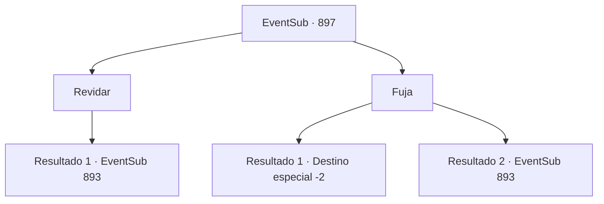

# Eventos secundários · 897

[Índice da tabela](index.md) · [Índice geral](../index.md)

ID: `pt:EventSub:897` · Fonte: `EventSub4` · Versão: 1.2.47.

Mapeamento estático dos arquivos; a disponibilidade e a execução dependem do estado da run.

## Texto do evento

*Sem texto no arquivo.*

## Dados de entrada

```json
{
  "id": 897,
  "grade": 1,
  "subEvent": "",
  "required": ""
}
```

## Mapa das escolhas



## Escolhas e resultados

### Escolha 1

Revidar

Requisitos e outros campos da escolha:

```json
{
  "required": ""
}
```

#### Resultado 1.1

Tentar fugir enquanto cercado assim seria inútil. Você decide lutar contra os Dragões Vermelhos.

Continuação registrada: [Evento 893](0893.md) na mesma tabela.

```json
{
  "required": "",
  "chance": "1",
  "nextEvent": 893,
  "type": 2,
  "reward": "6_3_179",
  "place": 10
}
```

### Escolha 2

Fuja

Requisitos e outros campos da escolha:

```json
{
  "required": ""
}
```

#### Resultado 2.1

Você procura uma abertura e avança no momento perfeito. 

 "O QUE VOCÊS ESTÃO FAZENDO?! IDIOTAS! VÃO!!"

 Você ouve Shao gritando frustrado atrás de você, mas ninguém consegue te alcançar. Você rapidamente deixa a área após despistar os perseguidores.

Continuação registrada: [Destino especial `-2`](../destinos-especiais.md).

```json
{
  "required": "",
  "chance": "1|0_6_1",
  "nextEvent": -2,
  "type": 0,
  "reward": "12_11_15"
}
```

#### Resultado 2.2

Você tenta fugir, mas já está cercado. É inútil. Você desiste de fugir e decide lutar contra os Dragões Vermelhos.

Continuação registrada: [Evento 893](0893.md) na mesma tabela.

```json
{
  "required": "",
  "chance": "18",
  "nextEvent": 893,
  "type": 1,
  "reward": "6_3_179",
  "place": 10
}
```

## Referências que chegam a este evento

- [Evento 896 · escolha 1 · resultado 1](0896.md#escolha-1)
- [Evento 896 · escolha 1 · resultado 2](0896.md#escolha-1)
- [Evento 896 · escolha 2 · resultado 1](0896.md#escolha-2)
- [Evento 896 · escolha 2 · resultado 2](0896.md#escolha-2)
- [Evento 896 · escolha 2 · resultado 4](0896.md#escolha-2)
- [Evento 896 · escolha 3 · resultado 1](0896.md#escolha-3)
- [Evento 896 · escolha 3 · resultado 2](0896.md#escolha-3)
