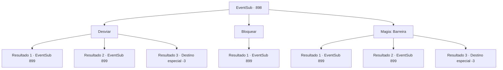

# Eventos secundários · 898

[Índice da tabela](index.md) · [Índice geral](../index.md)

ID: `pt:EventSub:898` · Fonte: `EventSub4` · Versão: 1.2.47.

Mapeamento estático dos arquivos; a disponibilidade e a execução dependem do estado da run.

## Texto do evento

Você está caminhando em um campo amplo e plano. O céu azul, os raios quentes do sol... é o clima perfeito para uma caminhada. Os juncos altos balançam ritmicamente ao vento. Então, você percebe uma arma brilhante em meio aos juncos, vindo em sua direção.

## Dados de entrada

```json
{
  "id": 898,
  "grade": 1,
  "subEvent": "",
  "required": "12_11_15"
}
```

## Mapa das escolhas



## Escolhas e resultados

### Escolha 1

Desviar 

Requisitos e outros campos da escolha:

```json
{
  "required": ""
}
```

#### Resultado 1.1

Você desvia da lâmina que se aproxima. Nesse momento, um grupo de assassinos emerge dos juncos. São os Red Drakes - os guerreiros pessoais de confiança de Shao. Sem dizer nada, eles começam a te bombardear com ataques.

Continuação registrada: [Evento 899](0899.md) na mesma tabela.

```json
{
  "required": "",
  "chance": "1|0_6_1",
  "nextEvent": 899,
  "type": 0,
  "reward": "6_0_179",
  "place": 0
}
```

#### Resultado 1.2

Você tenta desviar da lâmina que se aproxima, mas não é rápido o suficiente. A ponta da adaga lacera seu ombro ao passar por você. Nesse momento, um grupo de assassinos emerge dos juncos. São os Red Drakes - os guerreiros pessoais de confiança de Shao. Sem dizer nada, eles começam a te bombardear com ataques.

Continuação registrada: [Evento 899](0899.md) na mesma tabela.

```json
{
  "required": "1_0_2",
  "chance": "16",
  "nextEvent": 899,
  "type": 1,
  "reward": "0_0_-1|6_0_179",
  "place": 0
}
```

#### Resultado 1.3

Você tenta desviar da lâmina que se aproxima, mas não é rápido o suficiente. A lâmina da espada corta seu pescoço e pinta os juncos de vermelho. Você tenta estancar o sangramento, segurando seu pescoço, mas sem sucesso. Os Dracos Vermelhos saem de entre os juncos. Eles então começam a cravar suas armas em seu corpo indefeso.

Continuação registrada: [Destino especial `-3`](../destinos-especiais.md).

```json
{
  "required": "2_0_2",
  "chance": "16",
  "nextEvent": -3,
  "type": 1,
  "reward": "0_0_-1"
}
```

### Escolha 2

Bloquear

Requisitos e outros campos da escolha:

```json
{
  "required": "20_9_1"
}
```

#### Resultado 2.1

Você rapidamente bloqueia o ataque e verifica o atacante. Você foi atacado não por uma pessoa, nem por um completo estranho. São os Red Drakes - os guerreiros de Shao. Sem dizer nada, eles começam a te bombardear com ataques.

Continuação registrada: [Evento 899](0899.md) na mesma tabela.

```json
{
  "required": "",
  "chance": "1",
  "nextEvent": 899,
  "type": 2,
  "reward": "6_0_179",
  "place": 0
}
```

### Escolha 3

Magia: Barreira

Requisitos e outros campos da escolha:

```json
{
  "required": "20_0_1|1_1_2"
}
```

#### Resultado 3.1

Você lança uma barreira para se proteger. Nesse momento, um grupo de assassinos emerge dos juncos. São os Red Drakes - os guerreiros pessoais de confiança de Shao. Sem dizer nada, eles começam a te bombardear com ataques.

Continuação registrada: [Evento 899](0899.md) na mesma tabela.

```json
{
  "required": "",
  "chance": "1|0_14_1",
  "nextEvent": 899,
  "type": 0,
  "reward": "6_0_179|0_1_-1",
  "place": 0
}
```

#### Resultado 3.2

Você tenta lançar uma barreira, mas não é rápido o suficiente. A espada voa em sua direção. Nesse momento, um grupo de assassinos emerge dos juncos. São os Red Drakes - os guerreiros pessoais de confiança de Shao. Sem dizer nada, eles começam a te bombardear com ataques.

Continuação registrada: [Evento 899](0899.md) na mesma tabela.

```json
{
  "required": "1_0_2",
  "chance": "16",
  "nextEvent": 899,
  "type": 1,
  "reward": "0_0_-1|6_0_179",
  "place": 0
}
```

#### Resultado 3.3

Você tenta bloquear a lâmina que se aproxima, mas não é rápido o suficiente. A lâmina da espada corta seu pescoço e pinta os juncos de vermelho. Você tenta estancar o sangramento, segurando seu pescoço, mas sem sucesso. Os Drakes Vermelhos saem de entre os juncos. Eles então começam a cravar suas armas em seu corpo indefeso.

Continuação registrada: [Destino especial `-3`](../destinos-especiais.md).

```json
{
  "required": "2_0_2",
  "chance": "16",
  "nextEvent": -3,
  "type": 1,
  "reward": "0_0_-1"
}
```

## Referências que chegam a este evento

Nenhum `nextEvent` positivo da mesma tabela aponta para este nó. Isso não prova que seja inacessível: sorteio e estado de história podem selecioná-lo.

