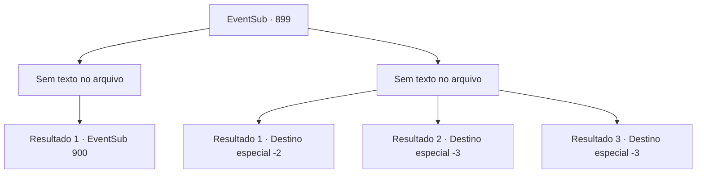

# Eventos secundários · 899

[Índice da tabela](index.md) · [Índice geral](../index.md)

ID: `pt:EventSub:899` · Fonte: `EventSub4` · Versão: 1.2.47.

Mapeamento estático dos arquivos; a disponibilidade e a execução dependem do estado da run.

## Texto do evento

*Sem texto no arquivo.*

## Dados de entrada

```json
{
  "id": 899,
  "grade": 1,
  "subEvent": "",
  "required": ""
}
```

## Mapa das escolhas



## Escolhas e resultados

### Escolha 1

*Sem texto no arquivo; o papel dessa opção depende da interface do jogo.*

Requisitos e outros campos da escolha:

```json
{
  "required": ""
}
```

#### Resultado 1.1

A emboscada deles e as exóticas artes marciais orientais são ambas frustradas por suas mãos. Você limpa o sangue do seu corpo e olha para o único sobrevivente. Ele é um guerreiro de aparência jovem, posicionado nas linhas de trás. Ele te encara com raiva por alguns segundos antes de abaixar a cabeça. 

 "Droga..."

 Você se aproxima do Red Drake sobrevivente e pergunta onde está Shao. Mas ele não diz nada, escolhendo ficar em silêncio e manter a cabeça baixa.

Continuação registrada: [Evento 900](0900.md) na mesma tabela.

```json
{
  "required": "",
  "chance": "1",
  "nextEvent": 900,
  "type": 2,
  "reward": ""
}
```

### Escolha 2

*Sem texto no arquivo; o papel dessa opção depende da interface do jogo.*

Requisitos e outros campos da escolha:

```json
{
  "required": ""
}
```

#### Resultado 2.1

Você é derrotado pelos guerreiros. Mas no último momento, você consegue mergulhar nos juncos e se esconder. Eles continuam a caçá-lo, mas não conseguem localizá-lo no campo de juncos. Você mal escapa dos atacantes com vida.

Continuação registrada: [Destino especial `-2`](../destinos-especiais.md).

```json
{
  "required": "1_0_2|1_1_2",
  "chance": "1",
  "nextEvent": -2,
  "type": 2,
  "reward": "0_0_-1|0_1_-1|12_11_-1|14_11_0|14_11_6"
}
```

#### Resultado 2.2

Você luta o máximo que pode, mas não é o suficiente. Infelizmente, seu corpo fica coberto de cortes e feridas e é deixado entre os juncos para apodrecer.

Continuação registrada: [Destino especial `-3`](../destinos-especiais.md).

```json
{
  "required": "2_0_2",
  "chance": "1",
  "nextEvent": -3,
  "type": 2,
  "reward": "0_0_-1|0_1_-1"
}
```

#### Resultado 2.3

Você luta o máximo que pode, mas não é o suficiente. Infelizmente, seu corpo fica coberto de cortes e feridas e é deixado entre os juncos para apodrecer.

Continuação registrada: [Destino especial `-3`](../destinos-especiais.md).

```json
{
  "required": "2_1_2",
  "chance": "1",
  "nextEvent": -3,
  "type": 2,
  "reward": "0_0_-1|0_1_-1"
}
```

## Referências que chegam a este evento

- [Evento 898 · escolha 1 · resultado 1](0898.md#escolha-1)
- [Evento 898 · escolha 1 · resultado 2](0898.md#escolha-1)
- [Evento 898 · escolha 2 · resultado 1](0898.md#escolha-2)
- [Evento 898 · escolha 3 · resultado 1](0898.md#escolha-3)
- [Evento 898 · escolha 3 · resultado 2](0898.md#escolha-3)
