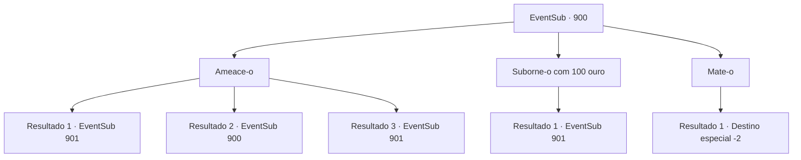

# Eventos secundários · 900

[Índice da tabela](index.md) · [Índice geral](../index.md)

ID: `pt:EventSub:900` · Fonte: `EventSub4` · Versão: 1.2.47.

Mapeamento estático dos arquivos; a disponibilidade e a execução dependem do estado da run.

## Texto do evento

*Sem texto no arquivo.*

## Dados de entrada

```json
{
  "id": 900,
  "grade": 1,
  "subEvent": "",
  "required": ""
}
```

## Mapa das escolhas



## Escolhas e resultados

### Escolha 1

Ameace-o

Requisitos e outros campos da escolha:

```json
{
  "required": "5_740_0"
}
```

#### Resultado 1.1

Você o agarra pela gola e começa a sacudir. Tomado pelo medo, ele começa a lhe contar tudo sobre o ataque. 

 "C- como você deve ter adivinhado, sim, a Srta. Shao nos enviou. Nenhuma ponta solta, ela disse."

 Ele engole em seco e continua. 

 "A- A Srta. Shao foi para Gladio, para competir no Torneio de Lutadores Battra. Ela já deve estar lá agora. Isso é tudo que eu sei!"


Continuação registrada: [Evento 901](0901.md) na mesma tabela.

```json
{
  "required": "21_1_3",
  "chance": "1|0_12_1",
  "nextEvent": 901,
  "type": 0,
  "reward": ""
}
```

#### Resultado 1.2

Aparentemente, sua intimidação não foi forte o suficiente para fazê-lo falar. Ele fala com determinação. 

 "Continue. Me mate."


Continuação registrada: [Evento 900](0900.md) na mesma tabela.

```json
{
  "required": "21_1_3",
  "chance": "15",
  "nextEvent": 900,
  "type": 1,
  "reward": "5_740_10"
}
```

#### Resultado 1.3

Você o agarra pela gola e começa a sacudir. Tomado pelo medo, ele começa a lhe contar tudo. 

 "S- Senhorita Shao foi para Gladio, para competir no Torneio de Lutadores Battra. Ela já deve estar lá agora. Isso é tudo que eu sei!"


Continuação registrada: [Evento 901](0901.md) na mesma tabela.

```json
{
  "required": "20_1_3",
  "chance": "1",
  "nextEvent": 901,
  "type": 2,
  "reward": ""
}
```

### Escolha 2

Suborne-o com 100 ouro

Requisitos e outros campos da escolha:

```json
{
  "required": "1_4_100"
}
```

#### Resultado 2.1

Você tira um pouco de ouro dos seus bolsos, enche uma bolsa com ele e a joga diante dele. O jovem guerreiro espreita dentro da bolsa e nota o ouro brilhante. Incapaz de resistir à tentação do ganho material, ele concorda em falar. 

 "A- A senhorita Shao foi para Gladio, para competir no Torneio de Lutadores Battra. Ela já deve estar lá agora. Isso é tudo que eu sei!"


Continuação registrada: [Evento 901](0901.md) na mesma tabela.

```json
{
  "required": "",
  "chance": "1",
  "nextEvent": 901,
  "type": 2,
  "reward": "0_4_-100"
}
```

### Escolha 3

Mate-o

Requisitos e outros campos da escolha:

```json
{
  "required": ""
}
```

#### Resultado 3.1

Você pôs fim à sua vida miserável. Um bando de corvos, observando a cena de longe, parte para o céu. Você decide caminhar na direção para onde eles estão indo também.

Continuação registrada: [Destino especial `-2`](../destinos-especiais.md).

```json
{
  "required": "",
  "chance": "1",
  "nextEvent": -2,
  "type": 2,
  "reward": "12_11_-1|14_11_0|14_11_6"
}
```

## Referências que chegam a este evento

- [Evento 899 · escolha 1 · resultado 1](0899.md#escolha-1)
- [Evento 900 · escolha 1 · resultado 2](0900.md#escolha-1)
