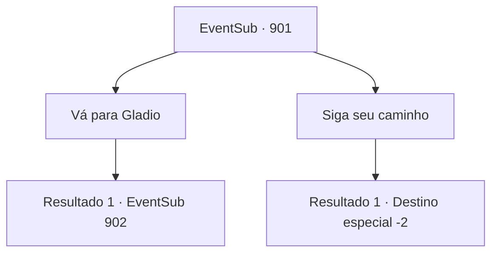

# Eventos secundários · 901

[Índice da tabela](index.md) · [Índice geral](../index.md)

ID: `pt:EventSub:901` · Fonte: `EventSub4` · Versão: 1.2.47.

Mapeamento estático dos arquivos; a disponibilidade e a execução dependem do estado da run.

## Texto do evento

*Sem texto no arquivo.*

## Dados de entrada

```json
{
  "id": 901,
  "grade": 1,
  "subEvent": "",
  "required": ""
}
```

## Mapa das escolhas



## Escolhas e resultados

### Escolha 1

Vá para Gladio

Requisitos e outros campos da escolha:

```json
{
  "required": ""
}
```

#### Resultado 1.1

Depois de te contar tudo, o jovem guerreiro corre para os juncos. Você se dirige a Gladio, deixando para trás o campo de juncos tremendo. A cidade não está tão longe. |drawing_Gladio| O lugar ainda parece cheio de alegria, provavelmente devido ao torneio que aconteceu aqui. Os comerciantes estão ocupados vendendo seus itens restantes para os locais, que por sua vez estão ocupados celebrando o vencedor do torneio. As ruas estão lotadas de pessoas indo e vindo.

Continuação registrada: [Evento 902](0902.md) na mesma tabela.

```json
{
  "required": "",
  "chance": "1",
  "nextEvent": 902,
  "type": 2,
  "reward": ""
}
```

### Escolha 2

Siga seu caminho

Requisitos e outros campos da escolha:

```json
{
  "required": ""
}
```

#### Resultado 2.1

Depois de te contar tudo, o jovem guerreiro corre para dentro dos juncos. Você se afasta, deixando o campo tremendo de juncos para trás.

Continuação registrada: [Destino especial `-2`](../destinos-especiais.md).

```json
{
  "required": "",
  "chance": "1",
  "nextEvent": -2,
  "type": 2,
  "reward": "12_11_-1|14_11_0|14_11_6"
}
```

## Referências que chegam a este evento

- [Evento 900 · escolha 1 · resultado 1](0900.md#escolha-1)
- [Evento 900 · escolha 1 · resultado 3](0900.md#escolha-1)
- [Evento 900 · escolha 2 · resultado 1](0900.md#escolha-2)
