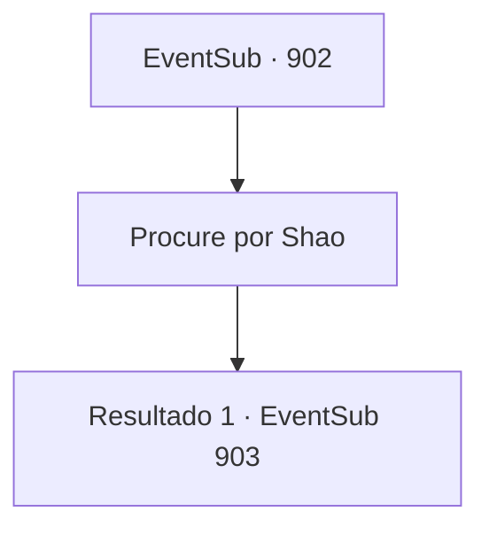

# Eventos secundários · 902

[Índice da tabela](index.md) · [Índice geral](../index.md)

ID: `pt:EventSub:902` · Fonte: `EventSub4` · Versão: 1.2.47.

Mapeamento estático dos arquivos; a disponibilidade e a execução dependem do estado da run.

## Texto do evento

*Sem texto no arquivo.*

## Dados de entrada

```json
{
  "id": 902,
  "grade": 1,
  "subEvent": "",
  "required": ""
}
```

## Mapa das escolhas



## Escolhas e resultados

### Escolha 1

Procure por Shao

Requisitos e outros campos da escolha:

```json
{
  "required": ""
}
```

#### Resultado 1.1

Não é difícil localizar Shao. Há um grande festival acontecendo na praça principal, celebrando o surgimento de um novo Mestre de Batalha. Você se depara com uma enorme multidão curtindo música e bebidas. Grupos de pessoas vestidas com trajes exóticos decorados com ouro e joias dançam ao seu redor. Um enorme elefante em armadura segue atrás. No topo do elefante estão artistas jogando pétalas no ar, sorrindo. |drawing_elephantFestival| Shao está se misturando com comerciantes e aristocratas, no centro da celebração. Você se esgueira pela multidão e se aproxima de Shao. O sorriso dela desaparece assim que ela nota seu rosto. Mas logo ela força um sorriso novamente, tratando você como um total estranho. 

 "Oh, hum... Como posso ajudá-lo? Você parece tão preocupado."

 A multidão começa a murmurar, reconhecendo a atmosfera suspeita entre você e Shao.

Continuação registrada: [Evento 903](0903.md) na mesma tabela.

```json
{
  "required": "",
  "chance": "1",
  "nextEvent": 903,
  "type": 2,
  "reward": ""
}
```

## Referências que chegam a este evento

- [Evento 901 · escolha 1 · resultado 1](0901.md#escolha-1)
