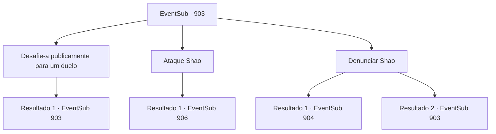

# Eventos secundários · 903

[Índice da tabela](index.md) · [Índice geral](../index.md)

ID: `pt:EventSub:903` · Fonte: `EventSub4` · Versão: 1.2.47.

Mapeamento estático dos arquivos; a disponibilidade e a execução dependem do estado da run.

## Texto do evento

*Sem texto no arquivo.*

## Dados de entrada

```json
{
  "id": 903,
  "grade": 1,
  "subEvent": "",
  "required": ""
}
```

## Mapa das escolhas



## Escolhas e resultados

### Escolha 1

Desafie-a publicamente para um duelo

Requisitos e outros campos da escolha:

```json
{
  "required": "5_741_0"
}
```

#### Resultado 1.1

Você desafia Shao para um duelo. Mas em vez de aceitar a luta, ela simplesmente desdenha. 

 "Huh. Eu teria duelado com você felizmente, se estivéssemos em um torneio oficial, mas esse navio já zarpou há muito tempo. Além disso, você acha que é apropriado para um Mestre de Batalha lutar com uma pessoa aleatória que apareceu do nada? O que vocês acham, pessoal?"

 A multidão explode em risadas e aplausos em resposta aos comentários de Shao. Alguns deles estão até gritando para você ir embora em vez de estragar o festival. Todos começam a te cobrir com vaias e zombarias.

Continuação registrada: [Evento 903](0903.md) na mesma tabela.

```json
{
  "required": "",
  "chance": "1",
  "nextEvent": 903,
  "type": 2,
  "reward": "5_741_1"
}
```

### Escolha 2

Ataque Shao

Requisitos e outros campos da escolha:

```json
{
  "required": ""
}
```

#### Resultado 2.1

Você ignora a multidão e ataca Shao de qualquer maneira. Mas você deve lutar contra outro grupo de pessoas para alcançá-la. Os guardas da cidade, em uma missão para escoltar o Mestre de Batalha. Eles sacam suas lanças e espadas e avançam contra você.

Continuação registrada: [Evento 906](0906.md) na mesma tabela.

```json
{
  "required": "",
  "chance": "1",
  "nextEvent": 906,
  "type": 2,
  "reward": "6_3_21",
  "place": 4
}
```

### Escolha 3

Denunciar Shao

Requisitos e outros campos da escolha:

```json
{
  "required": "5_762_0"
}
```

#### Resultado 3.1

Você grita para a multidão que Shao ordenou que seus homens o assassinassem. Em vez de parar por aí, você também expõe seu esquema para incapacitar Lei e Sanson. A atenção da multidão está fixa em Shao. Fazendo o melhor para esconder a frustração, ela responde. 

 "Huh... Eu não faço ideia do que você está falando. Pessoal, eu nem sei quem é essa pessoa. Por que eu tentaria assassinar alguém que nunca conheci? Você tem alguma prova, estranho?"

 Mas seu carisma por si só é suficiente para influenciar a multidão. Eles não dão a mínima para provas agora. Uma semente de dúvida já começou a brotar entre eles, sobre a possibilidade de que Shao possa ter usado meios obscuros para se livrar de seus rivais. À medida que a multidão se torna mais desconfiada, Shao finalmente puxa sua espada. Seu rosto está cheio de raiva. 

 "...Insultar-me é insultar meu clã. PREPARE-SE!"

 Assim que ela termina de falar, Shao avança em sua direção, brandindo sua espada.

Continuação registrada: [Evento 904](0904.md) na mesma tabela.

```json
{
  "required": "",
  "chance": "1|0_12_1",
  "nextEvent": 904,
  "type": 0,
  "reward": "6_0_183|5_762_1",
  "place": 4
}
```

#### Resultado 3.2

Você grita para a multidão que Shao ordenou que seus homens o assassinassem. Em vez de parar por aí, você também expõe o esquema dela para incapacitar Lei e Sanson. A atenção da multidão está fixa em Shao. Fazendo o melhor para esconder a frustração, ela responde. 

 "Huh... Eu não faço ideia do que você está falando. Pessoal, eu nem sei quem é essa pessoa. Por que eu tentaria assassinar alguém que nunca conheci? Você tem alguma prova, estranho?"

 A multidão começa a murmurar. Alguns deles estão até gritando para você ir embora em vez de arruinar o festival. Todos começam a zombar e vaiar você.

Continuação registrada: [Evento 903](0903.md) na mesma tabela.

```json
{
  "required": "",
  "chance": "24",
  "nextEvent": 903,
  "type": 1,
  "reward": "5_741_10|5_762_1"
}
```

## Referências que chegam a este evento

- [Evento 902 · escolha 1 · resultado 1](0902.md#escolha-1)
- [Evento 903 · escolha 1 · resultado 1](0903.md#escolha-1)
- [Evento 903 · escolha 3 · resultado 2](0903.md#escolha-3)
