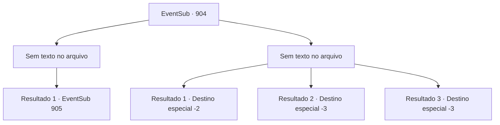

# Eventos secundários · 904

[Índice da tabela](index.md) · [Índice geral](../index.md)

ID: `pt:EventSub:904` · Fonte: `EventSub4` · Versão: 1.2.47.

Mapeamento estático dos arquivos; a disponibilidade e a execução dependem do estado da run.

## Texto do evento

*Sem texto no arquivo.*

## Dados de entrada

```json
{
  "id": 904,
  "grade": 1,
  "subEvent": "",
  "required": ""
}
```

## Mapa das escolhas



## Escolhas e resultados

### Escolha 1

*Sem texto no arquivo; o papel dessa opção depende da interface do jogo.*

Requisitos e outros campos da escolha:

```json
{
  "required": ""
}
```

#### Resultado 1.1

Quando Shao é levada aos joelhos, a multidão surpresa começa a exclamar. 

 "O- o Mestre de Batalha perdeu!!"

 Você se aproxima da perdedora. Shao range os dentes, olhando para você com olhos vermelhos.

Continuação registrada: [Evento 905](0905.md) na mesma tabela.

```json
{
  "required": "",
  "chance": "1",
  "nextEvent": 905,
  "type": 2,
  "reward": ""
}
```

### Escolha 2

*Sem texto no arquivo; o papel dessa opção depende da interface do jogo.*

Requisitos e outros campos da escolha:

```json
{
  "required": ""
}
```

#### Resultado 2.1

Você luta contra Shao com todas as suas forças, mas não consegue derrotá-la. Infelizmente, você é levado de joelhos diante dela. Shao poupa você, no entanto. Alguém da multidão a incentivou a não se envolver em derramamento de sangue desnecessário. Ela faz o melhor para parecer misericordiosa, embainha sua espada e se afasta. 

 "Alguém poderia gentilmente levar essa pobre pessoa ao tabernáculo? Eu odiaria que nosso dia de celebração fosse arruinado com a morte de um estranho."

 Ela dá uma olhada em você, depois se afasta rindo.

Continuação registrada: [Destino especial `-2`](../destinos-especiais.md).

```json
{
  "required": "1_0_2|1_1_2",
  "chance": "1",
  "nextEvent": -2,
  "type": 2,
  "reward": "0_0_-1|0_1_-1|12_11_-1|14_11_0|14_11_6"
}
```

#### Resultado 2.2

Um golpe chamativo corta seu pulso direito. Mesmo antes de sentir a dor, o próximo ataque vem. Ele perfura seu peito e empala seu coração. Ai de você, sua visão treme, e uma escuridão total preenche sua consciência.

Continuação registrada: [Destino especial `-3`](../destinos-especiais.md).

```json
{
  "required": "2_0_2",
  "chance": "1",
  "nextEvent": -3,
  "type": 2,
  "reward": "0_0_-1|0_1_-1"
}
```

#### Resultado 2.3

Um golpe chamativo corta seu pulso direito. Mesmo antes de sentir a dor, o próximo ataque vem. Ele perfura seu peito e empala seu coração. Infelizmente, sua visão treme, e uma escuridão total preenche sua consciência.

Continuação registrada: [Destino especial `-3`](../destinos-especiais.md).

```json
{
  "required": "2_1_2",
  "chance": "1",
  "nextEvent": -3,
  "type": 2,
  "reward": "0_0_-1|0_1_-1"
}
```

## Referências que chegam a este evento

- [Evento 903 · escolha 3 · resultado 1](0903.md#escolha-3)
- [Evento 906 · escolha 1 · resultado 1](0906.md#escolha-1)
