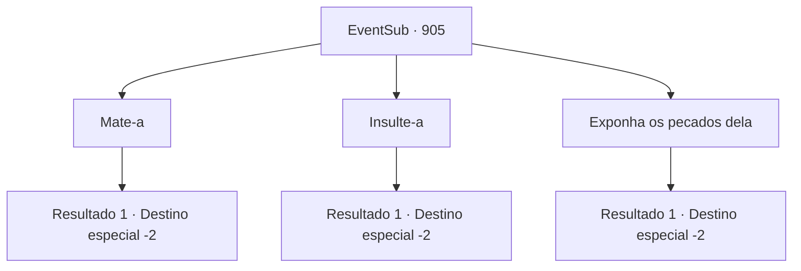

# Eventos secundários · 905

[Índice da tabela](index.md) · [Índice geral](../index.md)

ID: `pt:EventSub:905` · Fonte: `EventSub4` · Versão: 1.2.47.

Mapeamento estático dos arquivos; a disponibilidade e a execução dependem do estado da run.

## Texto do evento

*Sem texto no arquivo.*

## Dados de entrada

```json
{
  "id": 905,
  "grade": 1,
  "subEvent": "",
  "required": ""
}
```

## Mapa das escolhas



## Escolhas e resultados

### Escolha 1

Mate-a

Requisitos e outros campos da escolha:

```json
{
  "required": ""
}
```

#### Resultado 1.1

Você rapidamente pega a espada de Shao do chão. Sem hesitar, você a crava no coração de Shao. Tudo fica em silêncio. A reviravolta chocante dos eventos deixou todo o lugar quieto. A multidão olha para você sem palavras, mas você não dá a mínima atenção. Deixando para trás a praça ensanguentada, você se afasta e retorna às suas aventuras.

Continuação registrada: [Destino especial `-2`](../destinos-especiais.md).

```json
{
  "required": "",
  "chance": "1",
  "nextEvent": -2,
  "type": 2,
  "reward": "12_11_-1|14_11_9"
}
```

### Escolha 2

Insulte-a

Requisitos e outros campos da escolha:

```json
{
  "required": ""
}
```

#### Resultado 2.1

Você ri de Shao, insultando-a pela falta de destreza. Então, você tira a espada de sua mão e a quebra em pedaços. Shao grita com raiva para você, mas você não dá a mínima atenção e se afasta. A multidão começa a murmurar. Alguns deles estão abertamente duvidando das habilidades reais de Shao como lutadora.

Continuação registrada: [Destino especial `-2`](../destinos-especiais.md).

```json
{
  "required": "",
  "chance": "1",
  "nextEvent": -2,
  "type": 2,
  "reward": "12_11_-1|14_11_0|14_11_1|14_11_19"
}
```

### Escolha 3

Exponha os pecados dela

Requisitos e outros campos da escolha:

```json
{
  "required": "5_762_1"
}
```

#### Resultado 3.1

Você afirma que Shao não possui a habilidade necessária como lutadora. Além disso, que ela ordenou que seus guerreiros o assassinassem. Sua teoria se torna mais crível do que antes. A multidão já começou a acreditar em você. O rosto de Shao fica vermelho de constrangimento e raiva. Ela se move pela multidão e foge. A multidão começa a murmurar. Alguns deles estão abertamente duvidando das habilidades reais de Shao como lutadora.

Continuação registrada: [Destino especial `-2`](../destinos-especiais.md).

```json
{
  "required": "",
  "chance": "1",
  "nextEvent": -2,
  "type": 2,
  "reward": "12_11_-1|14_11_0|14_11_1|14_11_19"
}
```

## Referências que chegam a este evento

- [Evento 904 · escolha 1 · resultado 1](0904.md#escolha-1)
