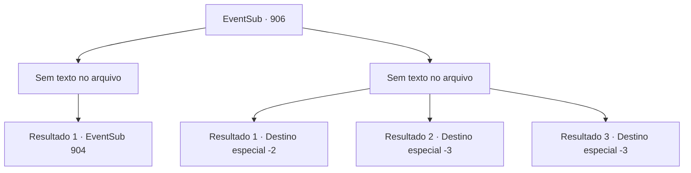

# Eventos secundários · 906

[Índice da tabela](index.md) · [Índice geral](../index.md)

ID: `pt:EventSub:906` · Fonte: `EventSub4` · Versão: 1.2.47.

Mapeamento estático dos arquivos; a disponibilidade e a execução dependem do estado da run.

## Texto do evento

*Sem texto no arquivo.*

## Dados de entrada

```json
{
  "id": 906,
  "grade": 1,
  "subEvent": "",
  "required": ""
}
```

## Mapa das escolhas



## Escolhas e resultados

### Escolha 1

*Sem texto no arquivo; o papel dessa opção depende da interface do jogo.*

Requisitos e outros campos da escolha:

```json
{
  "required": ""
}
```

#### Resultado 1.1

Você derrota todos os guardas e olha ao redor. A multidão ao seu redor está congelada de medo. Então, um deles fala. 

 "Não é o momento perfeito para um Mestre de Batalha intervir?"

 Sua opinião começa a ganhar mais e mais apoio. 

 "...Tudo bem. Eu mesma farei isso."

 Finalmente, Shao avança e puxa sua espada. Então, sem hesitação, ela avança em sua direção.

Continuação registrada: [Evento 904](0904.md) na mesma tabela.

```json
{
  "required": "",
  "chance": "1",
  "nextEvent": 904,
  "type": 2,
  "reward": "6_0_183",
  "place": 4
}
```

### Escolha 2

*Sem texto no arquivo; o papel dessa opção depende da interface do jogo.*

Requisitos e outros campos da escolha:

```json
{
  "required": ""
}
```

#### Resultado 2.1

Você é derrotado pelos guardas e perde a consciência. Você acorda dentro de uma cela de prisão. O carcereiro percebe que você está acordado. Ele bate na grade de aço, zombando de você. 

 "É exatamente por isso que você não deve causar uma cena no meio de uma cidade. Você vai apodrecer aqui pelos próximos dias."

 Após cerca de dez dias, você finalmente recupera sua liberdade. Tendo deixado a cidade, você encontra outro aventureiro na estrada e ouve notícias de Shao. 

 "Ah, a nova Mestre de Batalha? Ela partiu há muito tempo. Já deve estar a caminho de volta para o Oriente agora."

 Shao já está muito além do seu alcance. Infelizmente, você desiste de persegui-la e decide retornar às suas aventuras.

Continuação registrada: [Destino especial `-2`](../destinos-especiais.md).

```json
{
  "required": "1_0_2|1_1_2",
  "chance": "1",
  "nextEvent": -2,
  "type": 2,
  "reward": "0_0_-1|0_1_-1|12_11_-1|14_11_0|14_11_6"
}
```

#### Resultado 2.2

Você luta com todas as suas forças, mas isso acaba sendo um erro. Guardas enfurecidos lançam suas armas contra você com intenção assassina. Infelizmente, seu corpo é perfurado por inúmeras lâminas. Você encontra seu fim.

Continuação registrada: [Destino especial `-3`](../destinos-especiais.md).

```json
{
  "required": "2_0_2",
  "chance": "1",
  "nextEvent": -3,
  "type": 2,
  "reward": "0_0_-1|0_1_-1"
}
```

#### Resultado 2.3

Você luta com todas as suas forças, mas isso acaba sendo um erro. Guardas enfurecidos lançam suas armas contra você com intenção assassina. Infelizmente, seu corpo é perfurado por inúmeras lâminas. Você encontra seu fim.

Continuação registrada: [Destino especial `-3`](../destinos-especiais.md).

```json
{
  "required": "2_1_2",
  "chance": "1",
  "nextEvent": -3,
  "type": 2,
  "reward": "0_0_-1|0_1_-1"
}
```

## Referências que chegam a este evento

- [Evento 903 · escolha 2 · resultado 1](0903.md#escolha-2)
