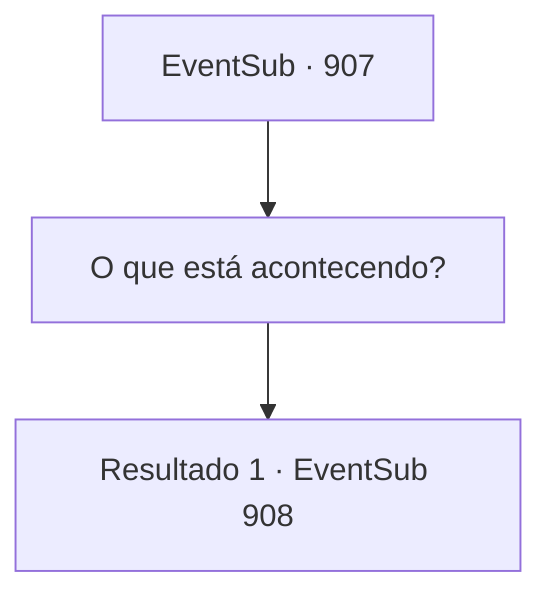

# Eventos secundários · 907

[Índice da tabela](index.md) · [Índice geral](../index.md)

ID: `pt:EventSub:907` · Fonte: `EventSub4` · Versão: 1.2.47.

Mapeamento estático dos arquivos; a disponibilidade e a execução dependem do estado da run.

## Texto do evento

Dentro de uma velha estalagem desgastada, você nota um grupo de cavaleiros em armaduras reluzentes. Inscrito em cada uma das armaduras de placa completa está um tridente azul. Por mais deslocados que parecessem, as placas de ferro bem cuidadas refletiam as tochas sombrias da estalagem, emitindo uma luz prateada. Em contraste, os cavaleiros pareciam tristes e deprimidos. 

 "*suspiro*... Não está na hora da senhora perder as esperanças?"

 "Eu entendo de onde isso vem, mas... não diga isso."

 Você supõe que eles estão reclamando do trabalho deles.

## Dados de entrada

```json
{
  "id": 907,
  "grade": 1,
  "subEvent": "",
  "required": "12_12_0"
}
```

## Mapa das escolhas



## Escolhas e resultados

### Escolha 1

O que está acontecendo?

Requisitos e outros campos da escolha:

```json
{
  "required": ""
}
```

#### Resultado 1.1

Você se aproxima do grupo de cavaleiros e pergunta o que os está incomodando. Um deles te examina de cima a baixo, então fala. 

 "Prazer em conhecê-lo. Meu nome é Lupin. Sou um cavaleiro que serve e protege o Conde Ronan."

 Você nota que ele está segurando um pedaço de pergaminho na mão. Desenhado nele está uma ilustração de um bebê. Um bebê com cabelo branco-prateado e olhos vermelhos carmesim. 

 "Você é um aventureiro, certo? Gostaria de pedir um favor."

 Segundo ele, há uma vila chamada Reckless dentro do condado de Ronan. Recentemente, por razões desconhecidas, a mina de prata local da vila foi forçada a fechar. 

 "Você poderia investigar o que está acontecendo lá? A mina de prata?"


Continuação registrada: [Evento 908](0908.md) na mesma tabela.

```json
{
  "required": "",
  "chance": "1",
  "nextEvent": 908,
  "type": 2,
  "reward": ""
}
```

## Referências que chegam a este evento

Nenhum `nextEvent` positivo da mesma tabela aponta para este nó. Isso não prova que seja inacessível: sorteio e estado de história podem selecioná-lo.

