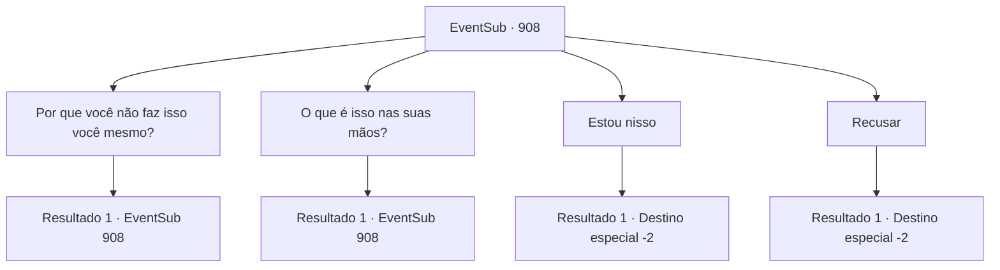

# Eventos secundários · 908

[Índice da tabela](index.md) · [Índice geral](../index.md)

ID: `pt:EventSub:908` · Fonte: `EventSub4` · Versão: 1.2.47.

Mapeamento estático dos arquivos; a disponibilidade e a execução dependem do estado da run.

## Texto do evento

*Sem texto no arquivo.*

## Dados de entrada

```json
{
  "id": 908,
  "grade": 1,
  "subEvent": "",
  "required": ""
}
```

## Mapa das escolhas



## Escolhas e resultados

### Escolha 1

Por que você não faz isso você mesmo?

Requisitos e outros campos da escolha:

```json
{
  "required": "5_775_0"
}
```

#### Resultado 1.1

Você pergunta ao cavaleiro por que ele mesmo não faz o trabalho. Em resposta, Lupin se inclina mais perto de você e sussurra. 

 "Ouça com atenção agora. Reckless é uma diocese - sob o controle do Bispo Lukas. Ele... está alegando que conseguiu selar um demônio na mina. É ele quem está proibindo todos de entrarem nela."

 Ele bate na cabeça com os dedos, bem protegidos pela sua manopla. 

 "E estou com a sensação de que esse homem está escondendo algo..."

 Lupin ri amargamente e acrescenta. 

 "Meu senhor parece confiar em Lukas, pelo menos. Não estou em posição de me aprofundar mais, com nada além de suspeitas. Mas... um aventureiro errante como você? Você pode ser a chave para este problema."


Continuação registrada: [Evento 908](0908.md) na mesma tabela.

```json
{
  "required": "",
  "chance": "1",
  "nextEvent": 908,
  "type": 2,
  "reward": "5_775_1"
}
```

### Escolha 2

O que é isso nas suas mãos?

Requisitos e outros campos da escolha:

```json
{
  "required": "5_774_0"
}
```

#### Resultado 2.1

Você pergunta a Lupin sobre o pergaminho em suas mãos. Ele o segura em sua direção para que você possa dar uma olhada melhor. 

 "Este é o filho do meu senhor, o Conde Ronan. Ele está desaparecido há alguns anos. N- nós podemos muito bem dizer que ele já se foi, mas..."

 Ele solta um breve suspiro e acrescenta. 

 "O Conde e sua esposa ainda não desistiram."

 Após um breve silêncio, Lupin continua com uma expressão amarga. 

 "Bem, o mínimo que posso fazer é continuar procurando por ele. Mas isso é outra história. Enquanto isso, gostaria que você investigasse a mina de prata."


Continuação registrada: [Evento 908](0908.md) na mesma tabela.

```json
{
  "required": "",
  "chance": "1",
  "nextEvent": 908,
  "type": 2,
  "reward": "3_362_1|5_774_1"
}
```

### Escolha 3

Estou nisso

Requisitos e outros campos da escolha:

```json
{
  "required": "5_775_1|5_774_1"
}
```

#### Resultado 3.1

Lupin sorri satisfeito, então abre um mapa da área ao redor de Reckless na mesa. 

 "A entrada da mina de prata deve estar por... ali. Dê uma olhada de perto, tá?"

 Ele acrescenta que está planejando ir lá também. Vocês dois concordam em se encontrar novamente perto do moinho de água da cidade.

Continuação registrada: [Destino especial `-2`](../destinos-especiais.md).

```json
{
  "required": "",
  "chance": "1",
  "nextEvent": -2,
  "type": 2,
  "reward": "12_12_1"
}
```

### Escolha 4

Recusar

Requisitos e outros campos da escolha:

```json
{
  "required": "5_775_1|5_774_1"
}
```

#### Resultado 4.1

Você recusa.   Ele não tenta convencê-lo mais.   

 "Ah, bem. Devo encontrar outra pessoa, então."

   Ele então sai da estalagem com seus companheiros cavaleiros.

Continuação registrada: [Destino especial `-2`](../destinos-especiais.md).

```json
{
  "required": "",
  "chance": "1",
  "nextEvent": -2,
  "type": 2,
  "reward": "12_12_-1"
}
```

## Referências que chegam a este evento

- [Evento 907 · escolha 1 · resultado 1](0907.md#escolha-1)
- [Evento 908 · escolha 1 · resultado 1](0908.md#escolha-1)
- [Evento 908 · escolha 2 · resultado 1](0908.md#escolha-2)
