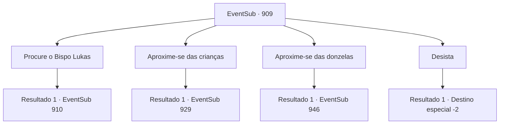

# Eventos secundários · 909

[Índice da tabela](index.md) · [Índice geral](../index.md)

ID: `pt:EventSub:909` · Fonte: `EventSub4` · Versão: 1.2.47.

Mapeamento estático dos arquivos; a disponibilidade e a execução dependem do estado da run.

## Texto do evento

|drawing_watermill| Você chega a Reckless, a vila que Lupin mencionou. Você se dirige ao local prometido - o moinho de água local - para se encontrar com ele. Ele olha para o rio que flui por um curto período, percebe sua presença e então se vira para cumprimentá-lo. 

 "Você está aqui. Eu estava apenas explorando. Consegui entrar na vila, mas o lugar não foi exatamente acolhedor. Fique de olho nesse diabo na mina, certo?"

 Ele dá um tapinha no seu ombro enquanto fala. Pelo jeito que ele falou, você pode perceber que ele não está convencido pela história do diabo. Você sobe a colina, até a vila de Reckless. Como Lupin disse, a vila não é exatamente um lugar acolhedor. As donzelas estão murmurando entre si, dando uma espiada em você de vez em quando. As crianças parecem focadas em brincar, ignorando você.

## Dados de entrada

```json
{
  "id": 909,
  "grade": 1,
  "subEvent": "",
  "required": "12_12_1|1_2_15"
}
```

## Mapa das escolhas



## Escolhas e resultados

### Escolha 1

Procure o Bispo Lukas

Requisitos e outros campos da escolha:

```json
{
  "required": "5_776_0"
}
```

#### Resultado 1.1

Você se dirige à igreja, localizada no centro da vila. Materiais de construção e equipamentos estão espalhados pela área, com trabalhadores os carregando de um lado para o outro, ocupados. Um homem em uma túnica de padre de veludo preto parece estar supervisionando o local de trabalho. Ele nota você, arruma seu cabelo loiro e oleoso, então olha para você friamente. 

 "Um forasteiro. Que negócios você tem aqui?"

 Ele responde à própria pergunta antes que você possa falar. 

 "Deve ser um dos caçadores de recompensas aqui pelo diabo na mina. Vá embora."

 Sua voz comanda tanto convicção quanto desprezo. 

 "Ninguém deve entrar lá. Se o diabo escapar... será a ruína desta vila. Saia."


Continuação registrada: [Evento 910](0910.md) na mesma tabela.

```json
{
  "required": "",
  "chance": "1",
  "nextEvent": 910,
  "type": 2,
  "reward": "5_776_1"
}
```

### Escolha 2

Aproxime-se das crianças

Requisitos e outros campos da escolha:

```json
{
  "required": "5_777_0"
}
```

#### Resultado 2.1

Você se aproxima das crianças e pergunta a elas sobre o diabo na mina. Elas te olham com cautela, como se seu mundo tivesse sido invadido por um intruso. 

 "Ah!! Um gigante! Um gigante das colinas apareceu!"

 As crianças apontam para você com gravetos nas mãos.

Continuação registrada: [Evento 929](0929.md) na mesma tabela.

```json
{
  "required": "",
  "chance": "1",
  "nextEvent": 929,
  "type": 2,
  "reward": "5_777_1"
}
```

### Escolha 3

Aproxime-se das donzelas

Requisitos e outros campos da escolha:

```json
{
  "required": "5_778_0"
}
```

#### Resultado 3.1

Assim que as donzelas veem você se aproximar, elas se dispersam, correndo para suas casas. Um velho nas proximidades observa a cena se desenrolar, então estala a língua. 

 "Tsch.. Venha aqui. Posso responder suas perguntas, se quiser."

 Ele gesticula para você se aproximar, sentado em um velho banco de madeira. O banco há muito perdeu sua cor, presumivelmente devido à exposição contínua aos raios do sol.

Continuação registrada: [Evento 946](0946.md) na mesma tabela.

```json
{
  "required": "",
  "chance": "1",
  "nextEvent": 946,
  "type": 2,
  "reward": "5_778_1"
}
```

### Escolha 4

Desista

Requisitos e outros campos da escolha:

```json
{
  "required": ""
}
```

#### Resultado 4.1

Você decide desistir do pedido de Lupin e sair.   Lupin está esperando por você fora da vila.   

 "Encontrou alguma coisa?"

   Você balança a cabeça. Você pode perceber que Lupin está desapontado ao ouvir a notícia.   

 "Entendo. Obrigado pela ajuda."

   Você se despede dele e retorna à sua aventura.

Continuação registrada: [Destino especial `-2`](../destinos-especiais.md).

```json
{
  "required": "",
  "chance": "1",
  "nextEvent": -2,
  "type": 2,
  "reward": "12_12_-1"
}
```

## Referências que chegam a este evento

- [Evento 911 · escolha 1 · resultado 3](0911.md#escolha-1)
- [Evento 911 · escolha 2 · resultado 2](0911.md#escolha-2)
- [Evento 911 · escolha 3 · resultado 1](0911.md#escolha-3)
- [Evento 929 · escolha 1 · resultado 2](0929.md#escolha-1)
- [Evento 929 · escolha 2 · resultado 1](0929.md#escolha-2)
