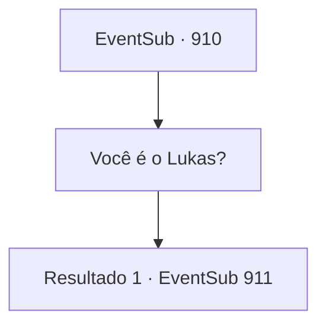

# Eventos secundários · 910

[Índice da tabela](index.md) · [Índice geral](../index.md)

ID: `pt:EventSub:910` · Fonte: `EventSub4` · Versão: 1.2.47.

Mapeamento estático dos arquivos; a disponibilidade e a execução dependem do estado da run.

## Texto do evento

*Sem texto no arquivo.*

## Dados de entrada

```json
{
  "id": 910,
  "grade": 1,
  "subEvent": "",
  "required": ""
}
```

## Mapa das escolhas



## Escolhas e resultados

### Escolha 1

Você é o Lukas?

Requisitos e outros campos da escolha:

```json
{
  "required": ""
}
```

#### Resultado 1.1

O homem acena em resposta. Ele então começa a falar. Sua voz é fria e seca. 

 "Sim. Eu sou 'Lukas El Parmera', o bispo desta aldeia. O próprio Conde me concedeu a soberania deste lugar. Seria do seu interesse partir e não se intrometer nos assuntos locais."


Continuação registrada: [Evento 911](0911.md) na mesma tabela.

```json
{
  "required": "",
  "chance": "1",
  "nextEvent": 911,
  "type": 2,
  "reward": ""
}
```

## Referências que chegam a este evento

- [Evento 909 · escolha 1 · resultado 1](0909.md#escolha-1)
