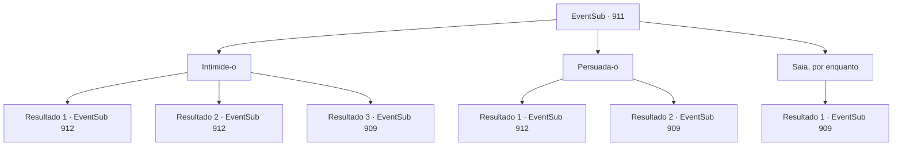

# Eventos secundários · 911

[Índice da tabela](index.md) · [Índice geral](../index.md)

ID: `pt:EventSub:911` · Fonte: `EventSub4` · Versão: 1.2.47.

Mapeamento estático dos arquivos; a disponibilidade e a execução dependem do estado da run.

## Texto do evento

*Sem texto no arquivo.*

## Dados de entrada

```json
{
  "id": 911,
  "grade": 1,
  "subEvent": "",
  "required": ""
}
```

## Mapa das escolhas



## Escolhas e resultados

### Escolha 1

Intimide-o

Requisitos e outros campos da escolha:

```json
{
  "required": ""
}
```

#### Resultado 1.1

Seu olhar ameaçador e intimidação habilidosa fazem maravilhas. O bispo relutantemente concorda em guiá-lo até a mina de prata. 

 "...Você é teimoso. Tudo bem."

 Você se dirige à Mina de Prata Reckless, seguindo Lukas. A entrada da mina fica fora da área da aldeia, localizada a cerca de dez minutos de distância. Quando você e Lukas se aproximam da entrada da mina, os soldados de plantão silenciosamente cumprimentam o bispo. 

 "Não vou impedi-lo, se você precisar... Mostre o caminho."

 Lukas suspira, acende uma tocha e se move atrás de você.

Continuação registrada: [Evento 912](0912.md) na mesma tabela.

```json
{
  "required": "20_5_4",
  "chance": "1|0_12_2",
  "nextEvent": 912,
  "type": 0,
  "reward": ""
}
```

#### Resultado 1.2

Seu olhar ameaçador e intimidação habilidosa fazem maravilhas. O bispo relutantemente concorda em guiá-lo até a mina de prata. 

 "...Você é teimoso. Tudo bem."

 Você se dirige à Mina de Prata Reckless, seguindo Lukas. A entrada da mina fica fora da área da aldeia, localizada a cerca de dez minutos de distância. Quando você e Lukas se aproximam da entrada da mina, os soldados de plantão silenciosamente cumprimentam o bispo. 

 "Não vou impedi-lo, se você precisar... Mostre o caminho."

 Lukas suspira, acende uma tocha e se move atrás de você.

Continuação registrada: [Evento 912](0912.md) na mesma tabela.

```json
{
  "required": "21_5_4",
  "chance": "1|0_12_1",
  "nextEvent": 912,
  "type": 0,
  "reward": ""
}
```

#### Resultado 1.3

Você tenta ameaçar Lukas, mas ele não cede. Em vez disso, ele responde irritado. 

 "Se você insistir em fazer uma cena, não tenho escolha a não ser lidar com você à força."

 Você decide recuar por enquanto e procurar outra maneira de investigar a mina.

Continuação registrada: [Evento 909](0909.md) na mesma tabela.

```json
{
  "required": "",
  "chance": "15",
  "nextEvent": 909,
  "type": 1,
  "reward": "5_776_9"
}
```

### Escolha 2

Persuada-o

Requisitos e outros campos da escolha:

```json
{
  "required": ""
}
```

#### Resultado 2.1

Usando lógica e argumento, você faz um discurso inteiro sobre como pode investigar a mina e lidar com o diabo nela. Quando você termina, Lukas está obviamente exausto e, por fim, relutantemente concorda em levá-lo à mina de prata. 

 "PARE. Pare. Meus ouvidos já estão sangrando. Certo, me siga."

 A entrada da mina fica fora da área da aldeia, localizada a cerca de dez minutos de distância. Quando você e Lukas se aproximam da entrada da mina, os soldados de plantão silenciosamente cumprimentam o bispo. 

 "Não vou impedi-lo, se você precisar... Mostre o caminho."

 Lukas suspira, acende uma tocha e se move atrás de você.

Continuação registrada: [Evento 912](0912.md) na mesma tabela.

```json
{
  "required": "",
  "chance": "1|0_7_1",
  "nextEvent": 912,
  "type": 0,
  "reward": ""
}
```

#### Resultado 2.2

Você tenta convencer Lukas de que tem o que é preciso para investigar a mina e lidar com o diabo. Mas você soa pouco convincente e ilógico, até para si mesmo. Ele responde irritado. 

 "Se você insiste em fazer uma cena, não tenho escolha a não ser lidar com você à força."

 Você decide recuar por enquanto e procurar outra maneira de investigar a mina.

Continuação registrada: [Evento 909](0909.md) na mesma tabela.

```json
{
  "required": "",
  "chance": "15",
  "nextEvent": 909,
  "type": 1,
  "reward": "5_776_9"
}
```

### Escolha 3

Saia, por enquanto

Requisitos e outros campos da escolha:

```json
{
  "required": ""
}
```

#### Resultado 3.1

Você decide ouvir Lukas e encontrar outra maneira de investigar a mina.

Continuação registrada: [Evento 909](0909.md) na mesma tabela.

```json
{
  "required": "",
  "chance": "1",
  "nextEvent": 909,
  "type": 2,
  "reward": "5_776_9"
}
```

## Referências que chegam a este evento

- [Evento 910 · escolha 1 · resultado 1](0910.md#escolha-1)
