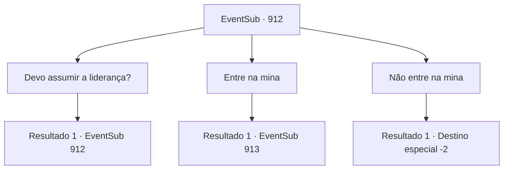

# Eventos secundários · 912

[Índice da tabela](index.md) · [Índice geral](../index.md)

ID: `pt:EventSub:912` · Fonte: `EventSub4` · Versão: 1.2.47.

Mapeamento estático dos arquivos; a disponibilidade e a execução dependem do estado da run.

## Texto do evento

*Sem texto no arquivo.*

## Dados de entrada

```json
{
  "id": 912,
  "grade": 1,
  "subEvent": "",
  "required": ""
}
```

## Mapa das escolhas



## Escolhas e resultados

### Escolha 1

Devo assumir a liderança?

Requisitos e outros campos da escolha:

```json
{
  "required": "5_779_0"
}
```

#### Resultado 1.1


 "...Não era óbvio? Você é quem insistiu em entrar lá. Vá na frente ou vá embora."

 Ele também acrescenta que ficaria feliz em escoltá-lo de volta à aldeia.

Continuação registrada: [Evento 912](0912.md) na mesma tabela.

```json
{
  "required": "",
  "chance": "1",
  "nextEvent": 912,
  "type": 2,
  "reward": "5_779_1"
}
```

### Escolha 2

Entre na mina

Requisitos e outros campos da escolha:

```json
{
  "required": ""
}
```

#### Resultado 2.1

Você entra na mina. Dentro da mina abandonada está completamente escuro. A luz fraca da tocha de Lukas é a única coisa que permite que você veja, embora vagamente. O cheiro de ferro e umidade enche o ar. Você não ouve nada enquanto caminha pelo túnel da mina. Após alguns minutos de descida, a luz da tocha desaparece de repente e tudo é engolido pela escuridão.

Continuação registrada: [Evento 913](0913.md) na mesma tabela.

```json
{
  "required": "",
  "chance": "1",
  "nextEvent": 913,
  "type": 2,
  "reward": ""
}
```

### Escolha 3

Não entre na mina

Requisitos e outros campos da escolha:

```json
{
  "required": ""
}
```

#### Resultado 3.1

Você decide não entrar na mina. 

 "...Caprichoso. Mas sábio."

 Você deixa para trás os comentários secos de Lukas e sai de Reckless. Lupin está esperando por você fora da vila. 

 "Encontrou alguma coisa?"

 Você balança a cabeça. Você pode perceber que Lupin está desapontado ao ouvir a notícia. 

 "Entendo. Obrigado pela ajuda."

 Você se despede dele e retorna à sua aventura.

Continuação registrada: [Destino especial `-2`](../destinos-especiais.md).

```json
{
  "required": "",
  "chance": "1",
  "nextEvent": -2,
  "type": 2,
  "reward": "12_12_-1"
}
```

## Referências que chegam a este evento

- [Evento 911 · escolha 1 · resultado 1](0911.md#escolha-1)
- [Evento 911 · escolha 1 · resultado 2](0911.md#escolha-1)
- [Evento 911 · escolha 2 · resultado 1](0911.md#escolha-2)
- [Evento 912 · escolha 1 · resultado 1](0912.md#escolha-1)
