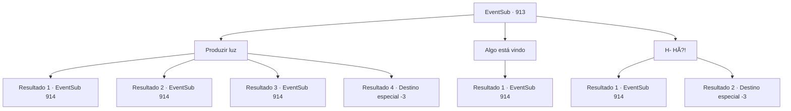

# Eventos secundários · 913

[Índice da tabela](index.md) · [Índice geral](../index.md)

ID: `pt:EventSub:913` · Fonte: `EventSub4` · Versão: 1.2.47.

Mapeamento estático dos arquivos; a disponibilidade e a execução dependem do estado da run.

## Texto do evento

*Sem texto no arquivo.*

## Dados de entrada

```json
{
  "id": 913,
  "grade": 1,
  "subEvent": "",
  "required": ""
}
```

## Mapa das escolhas



## Escolhas e resultados

### Escolha 1

Produzir luz

Requisitos e outros campos da escolha:

```json
{
  "required": "-1|23_3_1|20_0_1"
}
```

#### Resultado 1.1

Você revira seu inventário e encontra algo para dissipar a escuridão à sua frente. E então, percebe que estava prestes a ser emboscado - você avista dois homens armados se esgueirando em sua direção. 

 "Tsch...!"

 Você percebe que os olhos deles ainda estão se ajustando ao súbito clarão de luz. Eles avançam em sua direção, cada um apertando o punho em suas lanças.

Continuação registrada: [Evento 914](0914.md) na mesma tabela.

```json
{
  "required": "23_3_1",
  "chance": "1|0_6_1",
  "nextEvent": 914,
  "type": 0,
  "reward": "6_0_135",
  "place": 6
}
```

#### Resultado 1.2

Você rapidamente produz luz com magia, dissipando a escuridão à sua frente. E então, percebe que estava prestes a ser emboscado - você avista dois homens armados, se aproximando furtivamente de você. 

 "Tsch...!"

 Você percebe que os olhos deles ainda estão se ajustando ao súbito clarão de luz. Eles avançam em sua direção, cada um apertando o punho em suas lanças.

Continuação registrada: [Evento 914](0914.md) na mesma tabela.

```json
{
  "required": "20_0_1",
  "chance": "1|0_6_1",
  "nextEvent": 914,
  "type": 0,
  "reward": "6_0_135",
  "place": 6
}
```

#### Resultado 1.3

Você tenta produzir luz, mas algo o ataca da escuridão primeiro. Você sente um objeto afiado rasgando sua carne, e logo uma dor aguda se segue. Enquanto você luta para respirar, seus olhos finalmente se ajustam à escuridão. Você percebe que está cercado por seres encapuzados. Eles não hesitam nem um pouco, sem intenção de mostrar misericórdia. Rapidamente, você se prepara em uma postura defensiva antes que o próximo ataque o atinja.

Continuação registrada: [Evento 914](0914.md) na mesma tabela.

```json
{
  "required": "1_0_2",
  "chance": "16",
  "nextEvent": 914,
  "type": 1,
  "reward": "6_3_135|0_0_-1",
  "place": 6
}
```

#### Resultado 1.4

Você tenta produzir luz, mas algo te ataca da escuridão primeiro. Você sente um objeto afiado rasgando sua carne, e logo uma dor aguda se segue. E isso acabou sendo a última coisa que você sente.

Continuação registrada: [Destino especial `-3`](../destinos-especiais.md).

```json
{
  "required": "2_0_2",
  "chance": "16",
  "nextEvent": -3,
  "type": 1,
  "reward": "0_0_-1"
}
```

### Escolha 2

Algo está vindo

Requisitos e outros campos da escolha:

```json
{
  "required": "-1|20_26_1|20_27_1"
}
```

#### Resultado 2.1

Você instintivamente percebe uma presença se aproximando da escuridão. Logo você é emboscado por dois seres armados. Mas você conseguiu seguir o movimento deles, evitando o ataque com facilidade. 

 "Tsch...!!"

 Eles continuam a atacar imediatamente, sem hesitação.

Continuação registrada: [Evento 914](0914.md) na mesma tabela.

```json
{
  "required": "",
  "chance": "1",
  "nextEvent": 914,
  "type": 2,
  "reward": "6_0_135",
  "place": 6
}
```

### Escolha 3

H- HÃ?!

Requisitos e outros campos da escolha:

```json
{
  "required": ""
}
```

#### Resultado 3.1

Então, algo te ataca primeiro na escuridão. Você sente um objeto afiado rasgando sua carne, e logo uma dor aguda se segue. Enquanto você luta para respirar, seus olhos finalmente se ajustam à escuridão. Você percebe que está cercado por seres encapuzados. Eles não hesitam nem um pouco, sem intenção de mostrar misericórdia. Rapidamente, você se prepara em uma postura defensiva antes que o próximo ataque te atinja.

Continuação registrada: [Evento 914](0914.md) na mesma tabela.

```json
{
  "required": "1_0_2",
  "chance": "1",
  "nextEvent": 914,
  "type": 2,
  "reward": "6_3_135|0_0_-1",
  "place": 6
}
```

#### Resultado 3.2

Então, algo te ataca na escuridão. Você sente um objeto afiado rasgando sua carne, e logo uma dor aguda se segue. E isso acabou sendo a última coisa que você sente.

Continuação registrada: [Destino especial `-3`](../destinos-especiais.md).

```json
{
  "required": "2_0_2",
  "chance": "1",
  "nextEvent": -3,
  "type": 2,
  "reward": "0_0_-1"
}
```

## Referências que chegam a este evento

- [Evento 912 · escolha 2 · resultado 1](0912.md#escolha-2)
