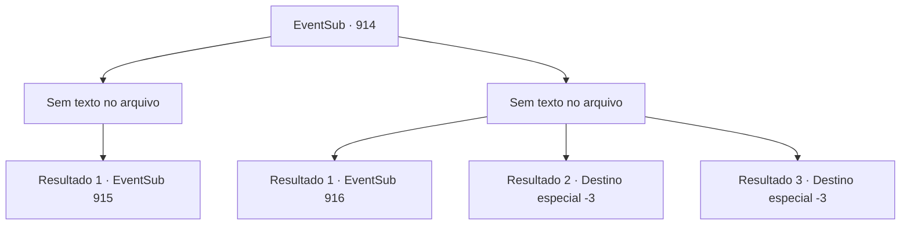

# Eventos secundários · 914

[Índice da tabela](index.md) · [Índice geral](../index.md)

ID: `pt:EventSub:914` · Fonte: `EventSub4` · Versão: 1.2.47.

Mapeamento estático dos arquivos; a disponibilidade e a execução dependem do estado da run.

## Texto do evento

*Sem texto no arquivo.*

## Dados de entrada

```json
{
  "id": 914,
  "grade": 1,
  "subEvent": "",
  "required": ""
}
```

## Mapa das escolhas



## Escolhas e resultados

### Escolha 1

*Sem texto no arquivo; o papel dessa opção depende da interface do jogo.*

Requisitos e outros campos da escolha:

```json
{
  "required": ""
}
```

#### Resultado 1.1

Você lida com os emboscadores armados, e a mina fica silenciosa novamente. Um som agudo de palmas quebra o silêncio. 

 "Nada mal. Você é muito melhor do que os aventureiros novatos até agora, tenho que admitir."

 Você olha para trás, apenas para encontrar Lukas parado longe de você.

Continuação registrada: [Evento 915](0915.md) na mesma tabela.

```json
{
  "required": "",
  "chance": "1",
  "nextEvent": 915,
  "type": 2,
  "reward": ""
}
```

### Escolha 2

*Sem texto no arquivo; o papel dessa opção depende da interface do jogo.*

Requisitos e outros campos da escolha:

```json
{
  "required": ""
}
```

#### Resultado 2.1

Você tenta revidar, mas não é páreo para os dois. Infelizmente, você é nocauteado, ensanguentado. Lukas olha para você, zombando. 

 "Era o que eu pensava. Já lidamos com uma dúzia - não faço ideia de por que vocês 'aventureiros' estão tão ansiosos para morrer."

 Você luta para respirar, enquanto Lukas continua. 

 "Pena. Quase sinto pena de você, sabe. Certo - talvez eu possa aliviar sua curiosidade antes de você morrer. Não há 'diabo' aqui. Eu só precisava de uma desculpa para fechar a mina."

 Ele ri, então faz um gesto para seus homens. 

 "Livrem-se deste. Joguem o corpo lá embaixo."

 Os subordinados de Lukas cumprem fielmente sua ordem, jogando seu corpo em um poço próximo. Alguns momentos depois, você se levanta dolorosamente. A pilha de cadáveres - a dúzia anterior que veio antes de você - amorteceu o suficiente para mantê-lo vivo.

Continuação registrada: [Evento 916](0916.md) na mesma tabela.

```json
{
  "required": "1_0_2|1_1_2",
  "chance": "1",
  "nextEvent": 916,
  "type": 2,
  "reward": "0_0_-1|0_1_-1"
}
```

#### Resultado 2.2

Você tenta revidar, mas não é páreo para os dois. Infelizmente, você é nocauteado, ensanguentado. Lukas olha para você, zombando. 

 "Era o que eu pensava. Já lidamos com uma dúzia. Aventureiros..."

 Você tenta se levantar, mas seu corpo não se move. Logo, você perde a consciência, sem ouvir o que Lukas tinha a dizer.

Continuação registrada: [Destino especial `-3`](../destinos-especiais.md).

```json
{
  "required": "2_0_2",
  "chance": "1",
  "nextEvent": -3,
  "type": 2,
  "reward": "0_0_-1|0_1_-1"
}
```

#### Resultado 2.3

Você tenta revidar, mas não é páreo para os dois. Infelizmente, você é nocauteado, ensanguentado. Lukas olha para você, zombando. 

 "Era o que eu pensava. Já lidamos com uma dúzia. Aventureiros..."

 Você tenta se levantar, mas seu corpo não se move. Logo, você perde a consciência, sem ouvir o que Lukas tinha a dizer.

Continuação registrada: [Destino especial `-3`](../destinos-especiais.md).

```json
{
  "required": "2_1_2",
  "chance": "1",
  "nextEvent": -3,
  "type": 2,
  "reward": "0_0_-1|0_1_-1"
}
```

## Referências que chegam a este evento

- [Evento 913 · escolha 1 · resultado 1](0913.md#escolha-1)
- [Evento 913 · escolha 1 · resultado 2](0913.md#escolha-1)
- [Evento 913 · escolha 1 · resultado 3](0913.md#escolha-1)
- [Evento 913 · escolha 2 · resultado 1](0913.md#escolha-2)
- [Evento 913 · escolha 3 · resultado 1](0913.md#escolha-3)
