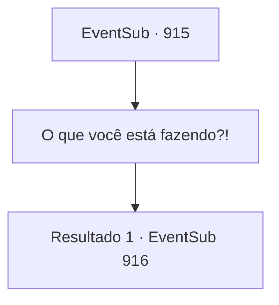

# Eventos secundários · 915

[Índice da tabela](index.md) · [Índice geral](../index.md)

ID: `pt:EventSub:915` · Fonte: `EventSub4` · Versão: 1.2.47.

Mapeamento estático dos arquivos; a disponibilidade e a execução dependem do estado da run.

## Texto do evento

*Sem texto no arquivo.*

## Dados de entrada

```json
{
  "id": 915,
  "grade": 1,
  "subEvent": "",
  "required": ""
}
```

## Mapa das escolhas



## Escolhas e resultados

### Escolha 1

O que você está fazendo?!

Requisitos e outros campos da escolha:

```json
{
  "required": ""
}
```

#### Resultado 1.1

Ele tira um pergaminho empoeirado do bolso, rindo. 

 "Você espera que eu simplesmente te diga isso?"

 Lukas rasga o pergaminho ao meio. A mina começa a tremer, enquanto a terra sob você se levanta. Você mal consegue se desviar do impacto. Mas agora você enfrenta um novo problema - uma pedra bloqueou a passagem para a saída.

Continuação registrada: [Evento 916](0916.md) na mesma tabela.

```json
{
  "required": "",
  "chance": "1",
  "nextEvent": 916,
  "type": 2,
  "reward": "5_780_1"
}
```

## Referências que chegam a este evento

- [Evento 914 · escolha 1 · resultado 1](0914.md#escolha-1)
