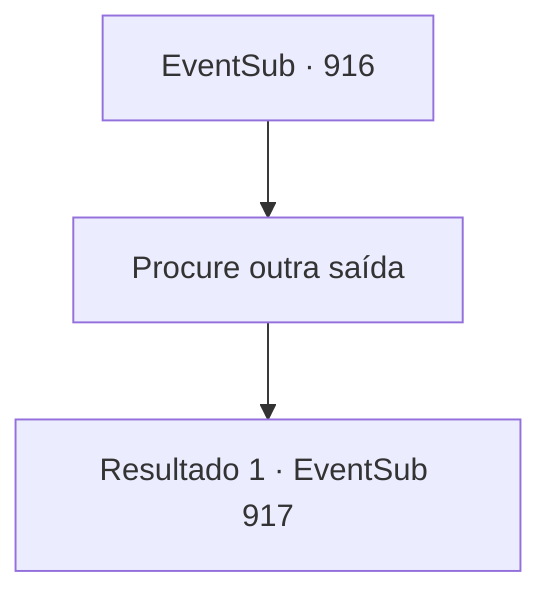

# Eventos secundários · 916

[Índice da tabela](index.md) · [Índice geral](../index.md)

ID: `pt:EventSub:916` · Fonte: `EventSub4` · Versão: 1.2.47.

Mapeamento estático dos arquivos; a disponibilidade e a execução dependem do estado da run.

## Texto do evento

*Sem texto no arquivo.*

## Dados de entrada

```json
{
  "id": 916,
  "grade": 1,
  "subEvent": "",
  "required": ""
}
```

## Mapa das escolhas



## Escolhas e resultados

### Escolha 1

Procure outra saída

Requisitos e outros campos da escolha:

```json
{
  "required": ""
}
```

#### Resultado 1.1

Você navega pelo entulho, na esperança de encontrar uma saída alternativa. Enquanto segue o trilho no chão da mina, ouve gemidos - alguém está com dor. Você rastreia o som até sua origem. Chega a um espaço estreito, que não parece tão abandonado em comparação com o resto da mina. Alguns baús de madeira estão espalhados aqui e ali. Você também nota uma mesa, junto com uma pena e alguns pedaços de pergaminho sobre ela. Do outro lado da sala há uma porta de ferro gradeada. Você se aproxima cuidadosamente da porta e olha para dentro. Lá, você nota uma criança pequena, agachada em um canto, tremendo. O menino tem pele pálida e cabelo branco-prateado. Você nota hematomas e cicatrizes de chicotadas por todo o corpo dele. Seus olhos estão cheios de medo e confusão. |drawing_chainedEdward|

Continuação registrada: [Evento 917](0917.md) na mesma tabela.

```json
{
  "required": "",
  "chance": "1",
  "nextEvent": 917,
  "type": 2,
  "reward": ""
}
```

## Referências que chegam a este evento

- [Evento 914 · escolha 2 · resultado 1](0914.md#escolha-2)
- [Evento 915 · escolha 1 · resultado 1](0915.md#escolha-1)
