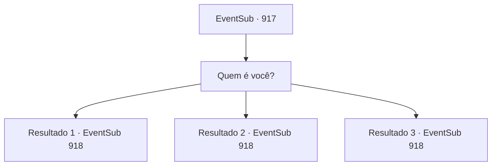

# Eventos secundários · 917

[Índice da tabela](index.md) · [Índice geral](../index.md)

ID: `pt:EventSub:917` · Fonte: `EventSub4` · Versão: 1.2.47.

Mapeamento estático dos arquivos; a disponibilidade e a execução dependem do estado da run.

## Texto do evento

*Sem texto no arquivo.*

## Dados de entrada

```json
{
  "id": 917,
  "grade": 1,
  "subEvent": "",
  "required": ""
}
```

## Mapa das escolhas



## Escolhas e resultados

### Escolha 1

Quem é você?

Requisitos e outros campos da escolha:

```json
{
  "required": ""
}
```

#### Resultado 1.1

O menino responde com uma voz quase inaudível, sem nem mesmo olhar para você. 

 "E-eu... eu não sei."

 O menino parece terrivelmente assustado com algo. Seus olhos vermelhos continuam a examinar os arredores, tentando se manter alerta. Nesse momento, enquanto você está olhando para o menino, você se lembra do desenho no pergaminho. A ilustração do filho do Conde Ronan, aquela que Lupin lhe mostrou. Você nota uma certa semelhança com o menino à sua frente. Então, com uma voz nervosa e trêmula, o menino murmura. 

 "O- o que aconteceu com o Senhor Lukas...?"


Continuação registrada: [Evento 918](0918.md) na mesma tabela.

```json
{
  "required": "10_362_1",
  "chance": "1|0_7_1",
  "nextEvent": 918,
  "type": 0,
  "reward": "5_781_1"
}
```

#### Resultado 1.2

O menino responde com uma voz quase inaudível, sem nem olhar para você. 

 "E... eu não sei."

 O menino parece terrivelmente assustado com algo. Seus olhos vermelhos continuam a examinar o ambiente. 

 "O- o que aconteceu com o Senhor Lukas...?"


Continuação registrada: [Evento 918](0918.md) na mesma tabela.

```json
{
  "required": "10_362_1",
  "chance": "10",
  "nextEvent": 918,
  "type": 1,
  "reward": ""
}
```

#### Resultado 1.3

O menino responde com uma voz quase inaudível, sem nem mesmo olhar para você. 

 "E-eu... eu não sei."

 O menino parece terrivelmente assustado com algo. Seus olhos vermelhos continuam a examinar os arredores, tentando se manter alerta. Nesse momento, enquanto você está olhando para o menino, você se lembra do desenho no pergaminho. A ilustração do filho do Conde Ronan, aquela que Lupin lhe mostrou. Você nota uma certa semelhança com o menino à sua frente. Então, com uma voz nervosa e trêmula, o menino murmura. 

 "O- o que aconteceu com o Senhor Lukas...?"


Continuação registrada: [Evento 918](0918.md) na mesma tabela.

```json
{
  "required": "8_362_1",
  "chance": "1",
  "nextEvent": 918,
  "type": 2,
  "reward": "5_781_1"
}
```

## Referências que chegam a este evento

- [Evento 916 · escolha 1 · resultado 1](0916.md#escolha-1)
- [Evento 950 · escolha 1 · resultado 1](0950.md#escolha-1)
- [Evento 952 · escolha 1 · resultado 1](0952.md#escolha-1)
