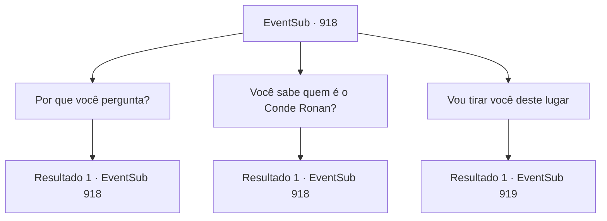

# Eventos secundários · 918

[Índice da tabela](index.md) · [Índice geral](../index.md)

ID: `pt:EventSub:918` · Fonte: `EventSub4` · Versão: 1.2.47.

Mapeamento estático dos arquivos; a disponibilidade e a execução dependem do estado da run.

## Texto do evento

*Sem texto no arquivo.*

## Dados de entrada

```json
{
  "id": 918,
  "grade": 1,
  "subEvent": "",
  "required": ""
}
```

## Mapa das escolhas



## Escolhas e resultados

### Escolha 1

Por que você pergunta?

Requisitos e outros campos da escolha:

```json
{
  "required": "5_782_0"
}
```

#### Resultado 1.1


 "M- Senhor Lukas...! Ele... cuida de mim! Quando eu me comporto bem e sou um bom menino... ele me recompensa com passas. Se eu não... ele me chicoteia."

 Os hematomas no corpo do menino devem ser obra do próprio Lukas.

Continuação registrada: [Evento 918](0918.md) na mesma tabela.

```json
{
  "required": "",
  "chance": "1",
  "nextEvent": 918,
  "type": 2,
  "reward": "5_782_1"
}
```

### Escolha 2

Você sabe quem é o Conde Ronan?

Requisitos e outros campos da escolha:

```json
{
  "required": "5_781_1"
}
```

#### Resultado 2.1

Você pergunta ao menino se ele sabe quem é o Conde Ronan. Mas ele apenas responde balançando a cabeça. 

 "Ronan? ...Nunca ouvi falar de alguém com esse nome."


Continuação registrada: [Evento 918](0918.md) na mesma tabela.

```json
{
  "required": "",
  "chance": "1",
  "nextEvent": 918,
  "type": 2,
  "reward": "5_781_2"
}
```

### Escolha 3

Vou tirar você deste lugar

Requisitos e outros campos da escolha:

```json
{
  "required": "5_782_1"
}
```

#### Resultado 3.1

O rosto do menino se ilumina ao ouvir você. 

 "R- realmente?! Mas ele disse que eu não posso..."

 O menino pondera algo em sua mente por um tempo. Ele fala novamente, aparentemente tendo tomado uma decisão. 

 "Eu... eu quero sair."


Continuação registrada: [Evento 919](0919.md) na mesma tabela.

```json
{
  "required": "",
  "chance": "1",
  "nextEvent": 919,
  "type": 2,
  "reward": ""
}
```

## Referências que chegam a este evento

- [Evento 917 · escolha 1 · resultado 1](0917.md#escolha-1)
- [Evento 917 · escolha 1 · resultado 2](0917.md#escolha-1)
- [Evento 917 · escolha 1 · resultado 3](0917.md#escolha-1)
- [Evento 918 · escolha 1 · resultado 1](0918.md#escolha-1)
- [Evento 918 · escolha 2 · resultado 1](0918.md#escolha-2)
