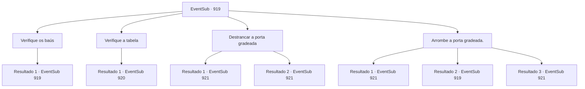

# Eventos secundários · 919

[Índice da tabela](index.md) · [Índice geral](../index.md)

ID: `pt:EventSub:919` · Fonte: `EventSub4` · Versão: 1.2.47.

Mapeamento estático dos arquivos; a disponibilidade e a execução dependem do estado da run.

## Texto do evento

*Sem texto no arquivo.*

## Dados de entrada

```json
{
  "id": 919,
  "grade": 1,
  "subEvent": "",
  "required": ""
}
```

## Mapa das escolhas



## Escolhas e resultados

### Escolha 1

Verifique os baús

Requisitos e outros campos da escolha:

```json
{
  "required": "5_783_0"
}
```

#### Resultado 1.1

Você examina um dos baús de madeira. Ao abri-lo, o fedor de madeira podre e ferrugem invade suas narinas. Dentro do baú há passas secas e um chicote ensanguentado. Debaixo deles, você encontra uma pequena chave. Você pega os itens do baú e o fecha novamente.

Continuação registrada: [Evento 919](0919.md) na mesma tabela.

```json
{
  "required": "",
  "chance": "1",
  "nextEvent": 919,
  "type": 2,
  "reward": "5_783_1|3_364_1|3_363_1"
}
```

### Escolha 2

Verifique a tabela

Requisitos e outros campos da escolha:

```json
{
  "required": "5_784_0"
}
```

#### Resultado 2.1

Você verifica a mesa. Nela há uma carta inacabada. Você percebe que quem a escreveu foi Lukas, enviada para alguém chamado 'Hazel'. O conteúdo da carta é o que você encontraria em uma carta de amor trocada entre amantes. Você nota que a mesa tem um armário trancado. Ao contrário das outras partes da mesa, que são feitas de madeira, esta prateleira trancada é feita de aço, junto com um grande e pesado cadeado protegendo-a.

Continuação registrada: [Evento 920](0920.md) na mesma tabela.

```json
{
  "required": "",
  "chance": "1",
  "nextEvent": 920,
  "type": 2,
  "reward": "5_784_1"
}
```

### Escolha 3

Destrancar a porta gradeada

Requisitos e outros campos da escolha:

```json
{
  "required": "-1|8_363_1|20_0_1|5_783_1"
}
```

#### Resultado 3.1

Com a chave que você encontrou no baú, você destranca a porta de ferro gradeada. Depois de libertar o menino, você olha ao redor, procurando um caminho para sair da mina. Enquanto considera suas opções, o menino está agachado no chão novamente, tocando um pequeno riacho de água que se formou naturalmente dentro do ambiente da caverna.

Continuação registrada: [Evento 921](0921.md) na mesma tabela.

```json
{
  "required": "8_363_1",
  "chance": "1",
  "nextEvent": 921,
  "type": 2,
  "reward": ""
}
```

#### Resultado 3.2

Com magia, você destranca a porta de ferro gradeada. Depois de libertar o menino, você olha ao redor, procurando um caminho para sair da mina. Enquanto considera suas opções, o menino está agachado no chão novamente, tocando um pequeno riacho de água que se formou naturalmente dentro do ambiente da caverna.

Continuação registrada: [Evento 921](0921.md) na mesma tabela.

```json
{
  "required": "20_0_1",
  "chance": "1",
  "nextEvent": 921,
  "type": 2,
  "reward": ""
}
```

### Escolha 4

Arrombe a porta gradeada.

Requisitos e outros campos da escolha:

```json
{
  "required": "5_785_0"
}
```

#### Resultado 4.1

Você segura as grades de ferro com as mãos e respira fundo. Com um grunhido, você torce as grades, criando uma abertura.  'CR-EEAAAAK--!!  As grades de ferro cedem à sua força brutal, soltando um grito horrendo. O menino consegue rastejar pela abertura para a liberdade. Depois de libertar o menino, você olha ao redor, procurando um caminho para sair da mina. Enquanto você considera suas opções, o menino está agachado no chão novamente, tocando um pequeno riacho de água que se formou naturalmente dentro do ambiente da caverna.

Continuação registrada: [Evento 921](0921.md) na mesma tabela.

```json
{
  "required": "21_60_2",
  "chance": "1|0_5_1",
  "nextEvent": 921,
  "type": 0,
  "reward": ""
}
```

#### Resultado 4.2

Você segura as grades de ferro com as mãos e respira fundo. Com um grunhido, você tenta torcer as grades para afastá-las. Mas as grades de ferro não se movem.

Continuação registrada: [Evento 919](0919.md) na mesma tabela.

```json
{
  "required": "21_60_2",
  "chance": "20",
  "nextEvent": 919,
  "type": 1,
  "reward": "5_785_9"
}
```

#### Resultado 4.3

Você segura as grades de ferro com as mãos e respira fundo. Com um grunhido, você torce as grades, criando uma abertura. 'CRANK-!!' As grades enferrujadas são puxadas limpidamente. O menino consegue rastejar pela abertura para a liberdade. Depois de libertar o menino, você olha ao redor, procurando um caminho para sair da mina. Enquanto você considera suas opções, o menino está agachado no chão novamente, tocando um pequeno riacho de água que se formou naturalmente dentro do ambiente da caverna.

Continuação registrada: [Evento 921](0921.md) na mesma tabela.

```json
{
  "required": "20_60_2",
  "chance": "1",
  "nextEvent": 921,
  "type": 2,
  "reward": ""
}
```

## Referências que chegam a este evento

- [Evento 918 · escolha 3 · resultado 1](0918.md#escolha-3)
- [Evento 919 · escolha 1 · resultado 1](0919.md#escolha-1)
- [Evento 919 · escolha 4 · resultado 2](0919.md#escolha-4)
- [Evento 920 · escolha 1 · resultado 1](0920.md#escolha-1)
- [Evento 920 · escolha 2 · resultado 1](0920.md#escolha-2)
- [Evento 920 · escolha 2 · resultado 3](0920.md#escolha-2)
- [Evento 920 · escolha 3 · resultado 1](0920.md#escolha-3)
- [Evento 920 · escolha 3 · resultado 3](0920.md#escolha-3)
- [Evento 920 · escolha 4 · resultado 1](0920.md#escolha-4)
