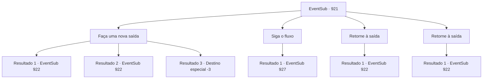

# Eventos secundários · 921

[Índice da tabela](index.md) · [Índice geral](../index.md)

ID: `pt:EventSub:921` · Fonte: `EventSub4` · Versão: 1.2.47.

Mapeamento estático dos arquivos; a disponibilidade e a execução dependem do estado da run.

## Texto do evento

*Sem texto no arquivo.*

## Dados de entrada

```json
{
  "id": 921,
  "grade": 1,
  "subEvent": "",
  "required": ""
}
```

## Mapa das escolhas



## Escolhas e resultados

### Escolha 1

Faça uma nova saída

Requisitos e outros campos da escolha:

```json
{
  "required": "5_780_1"
}
```

#### Resultado 1.1

Você escolta o garoto de cabelos brancos até a entrada da mina. Após alguns minutos, vocês dois chegam à parede de rocha que Lukas criou. Você pega uma picareta abandonada nas proximidades e começa a cavar imediatamente.  Algumas horas se passam. Você está encharcado de suor. Mas seu trabalho valeu a pena - você conseguiu abrir um pequeno buraco, mal grande o suficiente para um humano rastejar. Você se espreme pelo buraco para o outro lado. O garoto faz o mesmo. Mas, justo quando você pensou que estava seguro, encontra Lukas e seus homens diante de você. 

 "Peguem-nos! AGORA MESMO!"


Continuação registrada: [Evento 922](0922.md) na mesma tabela.

```json
{
  "required": "",
  "chance": "1|0_5_1",
  "nextEvent": 922,
  "type": 0,
  "reward": "3_44_1|6_3_135",
  "place": 6
}
```

#### Resultado 1.2

Você escolta o garoto de cabelos brancos até a entrada da mina. Após alguns minutos, vocês dois chegam à parede de rocha que Lukas criou. Você pega uma picareta abandonada por perto e começa a cavar imediatamente.  Algumas horas se passam. Você está encharcado de suor. De repente, uma pedra perde o equilíbrio devido à escavação contínua e cai em cima de você. 

 "V-você está bem?!"

 O garoto corre para ajudá-lo, fazendo o melhor para mover a pedra fora do lugar. Com a ajuda do garoto, você consegue empurrar a pedra para o lado. O impacto criou um pequeno buraco na parede - mal o suficiente para um humano rastejar. Você se espreme pelo buraco para o outro lado. O garoto faz o mesmo. Mas, quando você pensou que estava seguro, encontra Lukas e seus homens diante de você. 

 "Peguem-nos! AGORA MESMO!"


Continuação registrada: [Evento 922](0922.md) na mesma tabela.

```json
{
  "required": "1_0_2",
  "chance": "20",
  "nextEvent": 922,
  "type": 1,
  "reward": "3_44_1|6_3_135|0_0_-1",
  "place": 6
}
```

#### Resultado 1.3

Você escolta o garoto de cabelos brancos até a entrada da mina. Após alguns minutos, vocês dois chegam à parede de rocha que Lukas criou. Você pega uma picareta abandonada nas proximidades e começa a cavar imediatamente.  Algumas horas se passam. Você está encharcado de suor. De repente, uma pedra perde o equilíbrio devido à escavação contínua e cai em cima de você. 

 "V- você está bem?!"

 Infelizmente, essa é a última coisa que você ouve antes de perder a consciência.

Continuação registrada: [Destino especial `-3`](../destinos-especiais.md).

```json
{
  "required": "2_0_2",
  "chance": "20",
  "nextEvent": -3,
  "type": 1,
  "reward": "3_44_1|0_0_-1"
}
```

### Escolha 2

Siga o fluxo

Requisitos e outros campos da escolha:

```json
{
  "required": "5_789_0"
}
```

#### Resultado 2.1

Você olha para o fluxo de água no chão, rastreando cuidadosamente sua origem. Logo, você chega a uma pequena fonte subterrânea. Apesar do ambiente escuro e sombrio, a própria água parece estar brilhando.

Continuação registrada: [Evento 927](0927.md) na mesma tabela.

```json
{
  "required": "",
  "chance": "1",
  "nextEvent": 927,
  "type": 2,
  "reward": "5_789_1"
}
```

### Escolha 3

Retorne à saída

Requisitos e outros campos da escolha:

```json
{
  "required": "18_780_1|18_790_1"
}
```

#### Resultado 3.1

Você escolta o garoto de cabelos brancos até a entrada da mina. Após alguns minutos, vocês dois chegam à saída, com a luz do sol entrando por ela. Tentando evitar os raios de sol, o garoto franze a testa. 

 "A- argh...!"

 Mas justo quando você pensou que estava seguro, encontra Lukas e seus homens parados diante de você. Lukas percebe você e entra em pânico, gritando ordens. 

 "Como você ainda está vivo?! ...Peguem-nos! AGORA MESMO!"


Continuação registrada: [Evento 922](0922.md) na mesma tabela.

```json
{
  "required": "",
  "chance": "1",
  "nextEvent": 922,
  "type": 2,
  "reward": "6_3_135",
  "place": 1
}
```

### Escolha 4

Retorne à saída

Requisitos e outros campos da escolha:

```json
{
  "required": "5_790_1"
}
```

#### Resultado 4.1

Você escolta o garoto de cabelos brancos até a entrada da mina. Após alguns minutos, vocês dois chegam à saída, com a luz do sol entrando por ela. Tentando evitar os raios de sol, o garoto franze a testa. 

 "A- argh...!"

 Mas justo quando você pensou que estava seguro, encontra Lukas e seus homens parados diante de você. Lukas percebe você e entra em pânico, gritando ordens. 

 "O que vocês estão fazendo?! ...Peguem-nos! AGORA MESMO!"


Continuação registrada: [Evento 922](0922.md) na mesma tabela.

```json
{
  "required": "",
  "chance": "1",
  "nextEvent": 922,
  "type": 2,
  "reward": "6_3_135",
  "place": 1
}
```

## Referências que chegam a este evento

- [Evento 919 · escolha 3 · resultado 1](0919.md#escolha-3)
- [Evento 919 · escolha 3 · resultado 2](0919.md#escolha-3)
- [Evento 919 · escolha 4 · resultado 1](0919.md#escolha-4)
- [Evento 919 · escolha 4 · resultado 3](0919.md#escolha-4)
- [Evento 927 · escolha 1 · resultado 2](0927.md#escolha-1)
