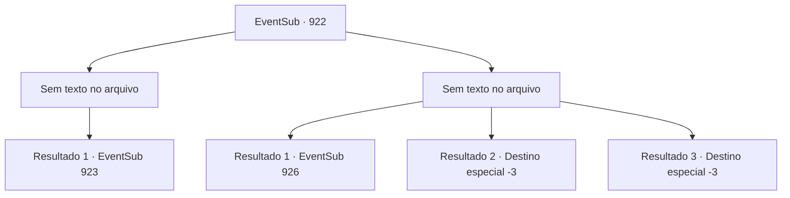

# Eventos secundários · 922

[Índice da tabela](index.md) · [Índice geral](../index.md)

ID: `pt:EventSub:922` · Fonte: `EventSub4` · Versão: 1.2.47.

Mapeamento estático dos arquivos; a disponibilidade e a execução dependem do estado da run.

## Texto do evento

*Sem texto no arquivo.*

## Dados de entrada

```json
{
  "id": 922,
  "grade": 1,
  "subEvent": "",
  "required": ""
}
```

## Mapa das escolhas



## Escolhas e resultados

### Escolha 1

*Sem texto no arquivo; o papel dessa opção depende da interface do jogo.*

Requisitos e outros campos da escolha:

```json
{
  "required": ""
}
```

#### Resultado 1.1

Não é uma tarefa fácil, lutar e proteger um garotinho indefeso ao mesmo tempo. Mas você conseguiu fazer isso. Um por um, você derrubou os homens de Lukas e, no final, saiu vitorioso. 

 "Uau..."

 O menino observa você lutar, maravilhado. Você o escolta de volta para onde Lupin está. Enquanto vocês dois atravessam a vila, os moradores se reúnem para assistir. Você não lhes dá atenção, saindo da vila. Finalmente, você se encontra com Lupin, que imediatamente faz uma pergunta. 

 "Encontrou alguma coisa?"


Continuação registrada: [Evento 923](0923.md) na mesma tabela.

```json
{
  "required": "",
  "chance": "1",
  "nextEvent": 923,
  "type": 2,
  "reward": ""
}
```

### Escolha 2

*Sem texto no arquivo; o papel dessa opção depende da interface do jogo.*

Requisitos e outros campos da escolha:

```json
{
  "required": ""
}
```

#### Resultado 2.1

Não é uma tarefa fácil, lutar e proteger um garotinho indefeso ao mesmo tempo. Enquanto você está enfrentando os homens armados, Lukas leva Edward e desaparece. Então, uma espada longa vem voando de algum lugar e se crava em um dos soldados. 

 "Ack...!"

 Os soldados restantes olham na direção de onde a espada veio. Você encontra Lupin lá, avançando em direção à batalha. Com facilidade, ele lida com os soldados restantes. 

 "Ufa... Ainda bem que decidi dar uma olhada. Você está bem? O que aconteceu?"


Continuação registrada: [Evento 926](0926.md) na mesma tabela.

```json
{
  "required": "1_0_2|1_1_2",
  "chance": "1",
  "nextEvent": 926,
  "type": 2,
  "reward": "0_0_-1|0_1_-1"
}
```

#### Resultado 2.2

Após ser atingido pelos homens de Lukas, você é jogado ao chão. Lukas olha para você de cima, zombando. 

 "Tsc. Tolo."

 Então, ele puxa uma maça da cintura e esmaga seu crânio com ela.

Continuação registrada: [Destino especial `-3`](../destinos-especiais.md).

```json
{
  "required": "2_0_2",
  "chance": "1",
  "nextEvent": -3,
  "type": 2,
  "reward": "0_0_-1|0_1_-1"
}
```

#### Resultado 2.3

Após ser atingido pelos homens de Lukas, você é jogado ao chão. Lukas olha para você de cima, zombando. 

 "Tsc. Tolo."

 Então, ele puxa uma maça da cintura e esmaga seu crânio com ela.

Continuação registrada: [Destino especial `-3`](../destinos-especiais.md).

```json
{
  "required": "2_1_2",
  "chance": "1",
  "nextEvent": -3,
  "type": 2,
  "reward": "0_0_-1|0_1_-1"
}
```

## Referências que chegam a este evento

- [Evento 921 · escolha 1 · resultado 1](0921.md#escolha-1)
- [Evento 921 · escolha 1 · resultado 2](0921.md#escolha-1)
- [Evento 921 · escolha 3 · resultado 1](0921.md#escolha-3)
- [Evento 921 · escolha 4 · resultado 1](0921.md#escolha-4)
