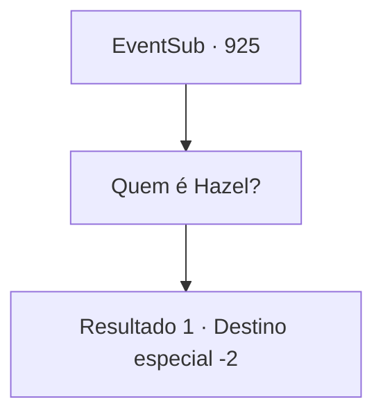

# Eventos secundários · 925

[Índice da tabela](index.md) · [Índice geral](../index.md)

ID: `pt:EventSub:925` · Fonte: `EventSub4` · Versão: 1.2.47.

Mapeamento estático dos arquivos; a disponibilidade e a execução dependem do estado da run.

## Texto do evento

*Sem texto no arquivo.*

## Dados de entrada

```json
{
  "id": 925,
  "grade": 1,
  "subEvent": "",
  "required": ""
}
```

## Mapa das escolhas



## Escolhas e resultados

### Escolha 1

Quem é Hazel?

Requisitos e outros campos da escolha:

```json
{
  "required": ""
}
```

#### Resultado 1.1


 "Hazel é a segunda esposa do Conde Ronan. Ela frequentemente mostrava abertamente ciúmes da primeira esposa dele, provavelmente porque Hazel vem de uma família praticamente sem nome, mas agora ela cruzou oficialmente a linha! Aquela mulher ingrata! Isso é simplesmente inaceitável!"

 Lupin logo consegue se acalmar, então começa a murmurar. 

 "Espere... Se o Jovem Mestre Edward voltasse, quem sabe quais novos planos os vilões poderiam tramar..."

 Após uma consideração cuidadosa, Lupin finalmente entrega sua conclusão, colocando a mão em seu ombro. 

 "Devo pedir que você encontre Lukas e... elimine-o. Eu assumirei total responsabilidade por qualquer coisa que se siga. Por favor, ajude-me a corrigir as coisas. De uma vez por todas."

 Lupin então sai, dizendo para você visitar o castelo do Conde Ronan.

Continuação registrada: [Destino especial `-2`](../destinos-especiais.md).

```json
{
  "required": "",
  "chance": "1",
  "nextEvent": -2,
  "type": 2,
  "reward": "12_12_3"
}
```

## Referências que chegam a este evento

- [Evento 924 · escolha 1 · resultado 1](0924.md#escolha-1)
