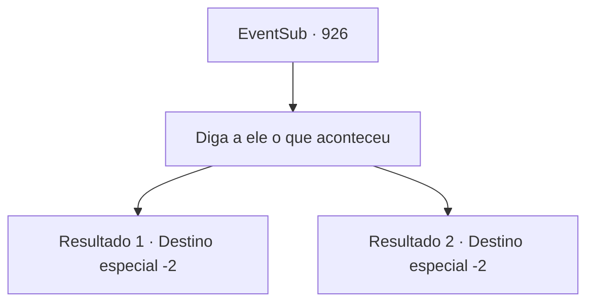

# Eventos secundários · 926

[Índice da tabela](index.md) · [Índice geral](../index.md)

ID: `pt:EventSub:926` · Fonte: `EventSub4` · Versão: 1.2.47.

Mapeamento estático dos arquivos; a disponibilidade e a execução dependem do estado da run.

## Texto do evento

*Sem texto no arquivo.*

## Dados de entrada

```json
{
  "id": 926,
  "grade": 1,
  "subEvent": "",
  "required": ""
}
```

## Mapa das escolhas



## Escolhas e resultados

### Escolha 1

Diga a ele o que aconteceu

Requisitos e outros campos da escolha:

```json
{
  "required": ""
}
```

#### Resultado 1.1

Você informa Lupin sobre os eventos que ocorreram na mina de prata. Depois de ouvir sua história, Lupin franze a testa e fica perdido em pensamentos. 

 "Ele estava escondendo um garoto de cabelos brancos o tempo todo... e fugiu com ele?!"

 Ele murmura algo inaudível para si mesmo e logo acena com a cabeça. 

 "Acredito que o garoto com quem Lukas desapareceu é o Jovem Mestre Edward. O filho do Conde Ronan."

 Ele parece bastante confiante. 

 "Eu sabia que o Bispo estava escondendo algo! Sempre senti que algo não estava certo."

 Lupin fica perdido em pensamentos por um breve momento e logo toma uma decisão. 

 "De qualquer forma. Devo retornar ao meu senhor por enquanto, para contar-lhe as novidades. Entrarei em contato com você novamente no futuro."

 Ele se despede rapidamente de você e sai apressadamente.

Continuação registrada: [Destino especial `-2`](../destinos-especiais.md).

```json
{
  "required": "18_786_1",
  "chance": "1",
  "nextEvent": -2,
  "type": 2,
  "reward": "12_12_4"
}
```

#### Resultado 1.2

Você informa Lupin sobre os eventos que ocorreram na mina de prata. Depois de ouvir sua história, Lupin franze a testa e fica pensativo. 

 "Ele estava escondendo um garoto de cabelos brancos que parecia com Edward, o filho do Conde Ronan, o tempo todo... e ele fugiu com ele?! Sabe de uma coisa? Acho que você está certo."

 Ele admite que sua inferência pode ser verdadeira e que concorda com você. 

 "Eu sabia que o Bispo estava escondendo algo! Sempre senti que algo não estava certo."

 Lupin fica pensativo por um breve momento e logo toma uma decisão. 

 "De qualquer forma. Devo retornar ao meu senhor por enquanto, para contar-lhe as novidades. Entrarei em contato com você novamente no futuro."

 Ele se despede rapidamente e sai apressadamente.

Continuação registrada: [Destino especial `-2`](../destinos-especiais.md).

```json
{
  "required": "5_786_1",
  "chance": "1",
  "nextEvent": -2,
  "type": 2,
  "reward": "12_12_12"
}
```

## Referências que chegam a este evento

- [Evento 922 · escolha 2 · resultado 1](0922.md#escolha-2)
