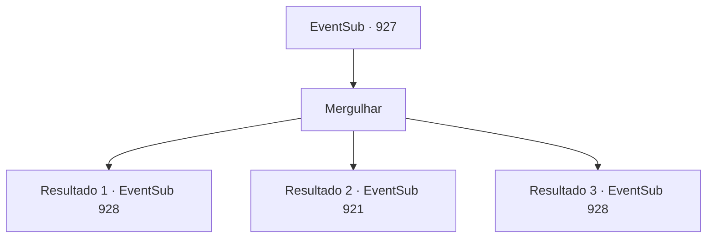

# Eventos secundários · 927

[Índice da tabela](index.md) · [Índice geral](../index.md)

ID: `pt:EventSub:927` · Fonte: `EventSub4` · Versão: 1.2.47.

Mapeamento estático dos arquivos; a disponibilidade e a execução dependem do estado da run.

## Texto do evento

*Sem texto no arquivo.*

## Dados de entrada

```json
{
  "id": 927,
  "grade": 1,
  "subEvent": "",
  "required": ""
}
```

## Mapa das escolhas



## Escolhas e resultados

### Escolha 1

Mergulhar

Requisitos e outros campos da escolha:

```json
{
  "required": ""
}
```

#### Resultado 1.1

Você mergulha na piscina de água brilhante. Você nada, seguindo a luz natural que deve ter se infiltrado de algum lugar. Logo, você encontra um pequeno buraco debaixo d'água, de onde vêm luz e água. O buraco é mal o suficiente para uma pessoa rastejar por ele. Depois de fazer uma anotação mental sobre a localização do buraco, você volta para buscar o menino. 

 "PHEWW--!"

 Você e o menino emergem da água clara e corrente. Um cardume de peixes pequenos se dispersa com o impacto na água. Os olhos do menino começam a brilhar de excitação, olhando para os peixes nadando para longe dele.

Continuação registrada: [Evento 928](0928.md) na mesma tabela.

```json
{
  "required": "21_31_1",
  "chance": "1|0_13_1",
  "nextEvent": 928,
  "type": 0,
  "reward": ""
}
```

#### Resultado 1.2

Você mergulha na piscina de água brilhante. Você nada, seguindo a luz natural que deve ter entrado de algum lugar. Mas você não consegue localizar uma saída, retornando de mãos vazias para onde o garoto está. Você ofega por ar assim que sai da água. O garoto olha para você preocupado. 

 "V- você está bem?"

 Sua respiração logo volta ao normal, e nesse momento, você decide procurar outra saída.

Continuação registrada: [Evento 921](0921.md) na mesma tabela.

```json
{
  "required": "21_31_1",
  "chance": "16",
  "nextEvent": 921,
  "type": 1,
  "reward": ""
}
```

#### Resultado 1.3

Você mergulha na piscina de água brilhante. Você nada, seguindo a luz natural que deve ter se infiltrado de algum lugar. Logo, você encontra um pequeno buraco debaixo d'água, de onde vêm luz e água. O buraco é mal o suficiente para uma pessoa rastejar por ele. Depois de fazer uma anotação mental sobre a localização do buraco, você volta para buscar o menino. 

 "PHEWW--!"

 Você e o menino emergem da água clara e corrente. Um cardume de peixes pequenos se dispersa com o impacto na água. Os olhos do menino começam a brilhar de excitação, olhando para os peixes nadando para longe dele.

Continuação registrada: [Evento 928](0928.md) na mesma tabela.

```json
{
  "required": "20_31_1",
  "chance": "1",
  "nextEvent": 928,
  "type": 2,
  "reward": ""
}
```

## Referências que chegam a este evento

- [Evento 921 · escolha 2 · resultado 1](0921.md#escolha-2)
