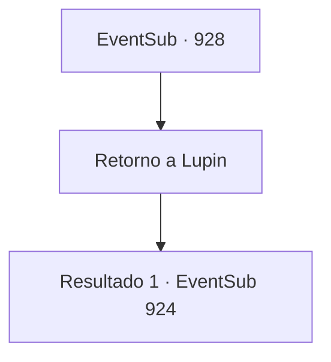

# Eventos secundários · 928

[Índice da tabela](index.md) · [Índice geral](../index.md)

ID: `pt:EventSub:928` · Fonte: `EventSub4` · Versão: 1.2.47.

Mapeamento estático dos arquivos; a disponibilidade e a execução dependem do estado da run.

## Texto do evento

*Sem texto no arquivo.*

## Dados de entrada

```json
{
  "id": 928,
  "grade": 1,
  "subEvent": "",
  "required": ""
}
```

## Mapa das escolhas



## Escolhas e resultados

### Escolha 1

Retorno a Lupin

Requisitos e outros campos da escolha:

```json
{
  "required": ""
}
```

#### Resultado 1.1

Com o garoto acompanhando, você retorna a Lupin. Ele está vagando pela vila sem rumo - mas assim que ele te vê, ele se move em sua direção. 

 "Encontrou alguma coisa?"

 Você informa Lupin sobre os eventos que ocorreram na mina de prata. Notando o garoto atrás de você, ele pede para o menino vir para frente. Após examinar o garoto por um breve momento, os olhos de Lupin se arregalam enquanto ele grita. 

 "N- não pode ser...! Jovem Mestre Edward?! Não pode ser! Pensar que ele estava preso na mina o tempo todo...!"

 Lupin se ajoelha como um sinal de respeito. Edward apenas fica ali, silencioso e confuso, tentando entender o que tudo isso significava. Lupin se levanta e continua. 

 "Você fez um ótimo trabalho, aventureiro. Eu cuido disso a partir daqui. Vou levar o Jovem Mestre Edward para um lugar seguro."

 Lupin soa determinado. 

 "A verdadeira questão é, por que Lukas cometeria um ato tão hediondo em primeiro lugar... Alguma ideia?"


Continuação registrada: [Evento 924](0924.md) na mesma tabela.

```json
{
  "required": "",
  "chance": "1",
  "nextEvent": 924,
  "type": 2,
  "reward": ""
}
```

## Referências que chegam a este evento

- [Evento 927 · escolha 1 · resultado 1](0927.md#escolha-1)
- [Evento 927 · escolha 1 · resultado 3](0927.md#escolha-1)
