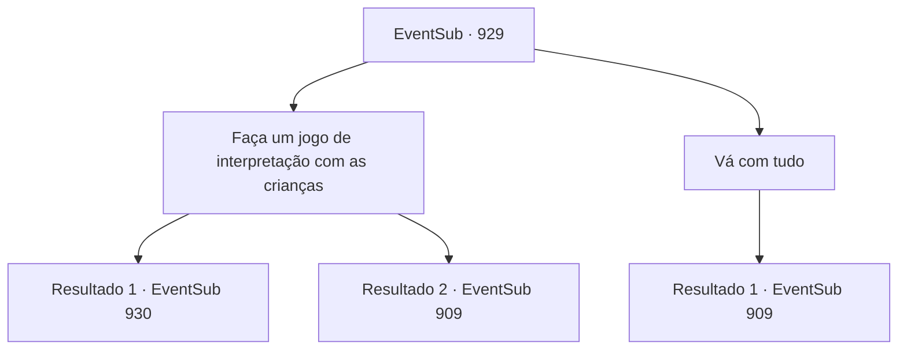

# Eventos secundários · 929

[Índice da tabela](index.md) · [Índice geral](../index.md)

ID: `pt:EventSub:929` · Fonte: `EventSub4` · Versão: 1.2.47.

Mapeamento estático dos arquivos; a disponibilidade e a execução dependem do estado da run.

## Texto do evento

*Sem texto no arquivo.*

## Dados de entrada

```json
{
  "id": 929,
  "grade": 1,
  "subEvent": "",
  "required": ""
}
```

## Mapa das escolhas



## Escolhas e resultados

### Escolha 1

Faça um jogo de interpretação com as crianças

Requisitos e outros campos da escolha:

```json
{
  "required": ""
}
```

#### Resultado 1.1

Você decide interpretar seu papel no jogo das crianças. As crianças parecem satisfeitas - você pode ver isso pelos sorrisos brilhantes delas. 

 "*ofegante*... *ofegante*... NÓS CONSEGUIMOS! DERROTAMOS O GIGANTE!"

 "YAAAAAYY--!!"

 As crianças parecem ter gostado de você. Todas se juntam a você, como se estivessem implorando para você brincar mais. Então, uma menina que interpretou o papel de espadachim se apresenta como 'Erina' e fala. 

 "Você queria saber sobre o diabo na mina, certo?"

 Erina olha ao redor para se certificar de que ninguém está escutando. Ela dá um passo mais perto de você e sussurra. 

 "Os adultos nos disseram para não nos aproximarmos da mina. NUNCA. Eles disseram que há um diabo perigoso selado lá dentro. Homens de aparência assustadora com lanças estão guardando a entrada também! Mas....!"

 A menina sorri de forma travessa. 

 "Eu na verdade conheço uma entrada secreta. Hihihi."


Continuação registrada: [Evento 930](0930.md) na mesma tabela.

```json
{
  "required": "",
  "chance": "1|0_12_1",
  "nextEvent": 930,
  "type": 0,
  "reward": ""
}
```

#### Resultado 1.2

Você faz o seu melhor para brincar com as crianças. Mas, aparentemente, elas não ficaram satisfeitas com suas habilidades de atuação. 

 "Ah... Sem graça. Vamos, pessoal."

 As crianças decidem que é hora de voltar para suas casas.

Continuação registrada: [Evento 909](0909.md) na mesma tabela.

```json
{
  "required": "",
  "chance": "14",
  "nextEvent": 909,
  "type": 1,
  "reward": "5_777_9"
}
```

### Escolha 2

Vá com tudo

Requisitos e outros campos da escolha:

```json
{
  "required": ""
}
```

#### Resultado 2.1

Você revida contra as crianças como se sua vida dependesse disso. Conseguiu assustar as crianças, pelo menos. Todas começaram a chorar. 

 "WAH--! Estou com medo!!"

 "Vou para casa..."

 As crianças decidem que é hora de voltar para suas casas.

Continuação registrada: [Evento 909](0909.md) na mesma tabela.

```json
{
  "required": "",
  "chance": "1",
  "nextEvent": 909,
  "type": 2,
  "reward": "5_777_9|0_3_-1"
}
```

## Referências que chegam a este evento

- [Evento 909 · escolha 2 · resultado 1](0909.md#escolha-2)
