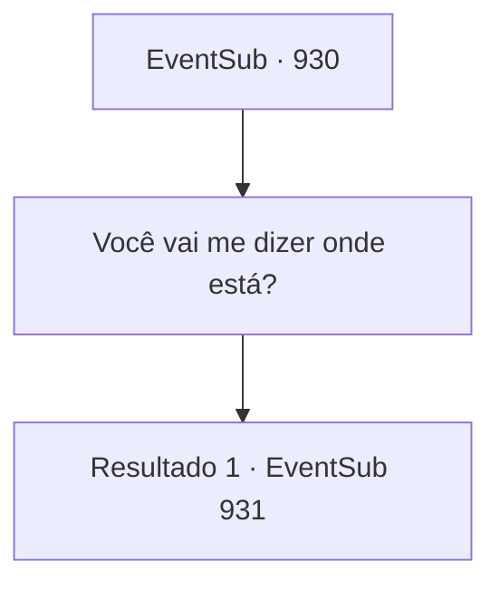

# Eventos secundários · 930

[Índice da tabela](index.md) · [Índice geral](../index.md)

ID: `pt:EventSub:930` · Fonte: `EventSub4` · Versão: 1.2.47.

Mapeamento estático dos arquivos; a disponibilidade e a execução dependem do estado da run.

## Texto do evento

*Sem texto no arquivo.*

## Dados de entrada

```json
{
  "id": 930,
  "grade": 1,
  "subEvent": "",
  "required": ""
}
```

## Mapa das escolhas



## Escolhas e resultados

### Escolha 1

Você vai me dizer onde está?

Requisitos e outros campos da escolha:

```json
{
  "required": ""
}
```

#### Resultado 1.1

Erina acena em resposta, então gesticula para você segui-la. As outras crianças tinham medo de serem repreendidas pelos adultos. Não Erina - ela não se importava. 

 "Fiquem parados, pessoal. Tudo o que vou fazer é dar uma dica de onde está."

 Você segue Erina, chegando a um pequeno riacho. Ela aponta para as pedras, onde você encontra uma pequena abertura, por onde a água estava fluindo. 

 "Você pode nadar até o buraco ali, e ele te levará à mina de prata."


Continuação registrada: [Evento 931](0931.md) na mesma tabela.

```json
{
  "required": "",
  "chance": "1",
  "nextEvent": 931,
  "type": 2,
  "reward": ""
}
```

## Referências que chegam a este evento

- [Evento 929 · escolha 1 · resultado 1](0929.md#escolha-1)
