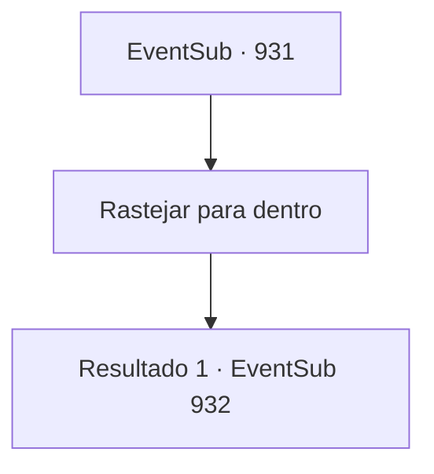

# Eventos secundários · 931

[Índice da tabela](index.md) · [Índice geral](../index.md)

ID: `pt:EventSub:931` · Fonte: `EventSub4` · Versão: 1.2.47.

Mapeamento estático dos arquivos; a disponibilidade e a execução dependem do estado da run.

## Texto do evento

*Sem texto no arquivo.*

## Dados de entrada

```json
{
  "id": 931,
  "grade": 1,
  "subEvent": "",
  "required": ""
}
```

## Mapa das escolhas



## Escolhas e resultados

### Escolha 1

Rastejar para dentro

Requisitos e outros campos da escolha:

```json
{
  "required": ""
}
```

#### Resultado 1.1

Você segue Erina, espremendo-se pela abertura estreita. Quanto mais fundo você vai, mais escuro fica. Logo, você se encontra dentro do poço da mina. 

 "Ufa!"

 As roupas de Erina estavam todas encharcadas agora, mas ela parece despreocupada. A garota corajosamente avança e declara. 

 "Eu vou na frente! Consigo ver bem no escuro!"


Continuação registrada: [Evento 932](0932.md) na mesma tabela.

```json
{
  "required": "",
  "chance": "1",
  "nextEvent": 932,
  "type": 2,
  "reward": ""
}
```

## Referências que chegam a este evento

- [Evento 930 · escolha 1 · resultado 1](0930.md#escolha-1)
