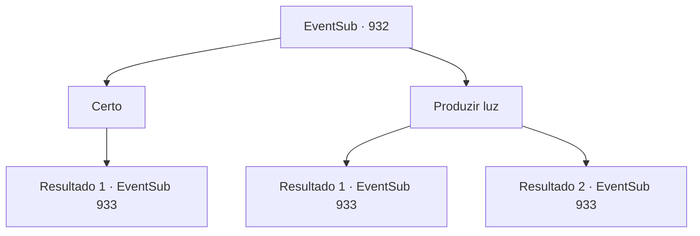

# Eventos secundários · 932

[Índice da tabela](index.md) · [Índice geral](../index.md)

ID: `pt:EventSub:932` · Fonte: `EventSub4` · Versão: 1.2.47.

Mapeamento estático dos arquivos; a disponibilidade e a execução dependem do estado da run.

## Texto do evento

*Sem texto no arquivo.*

## Dados de entrada

```json
{
  "id": 932,
  "grade": 1,
  "subEvent": "",
  "required": ""
}
```

## Mapa das escolhas



## Escolhas e resultados

### Escolha 1

Certo

Requisitos e outros campos da escolha:

```json
{
  "required": ""
}
```

#### Resultado 1.1

Você deixa Erina ir primeiro, seguindo-a para os níveis mais profundos da mina. Logo, Erina avista algo no escuro. 

 "Oh! Olá!"

 Ao ouvir sua saudação educada, os seres misteriosos no escuro gritam, assustados. 

 "O QUÊ?! Quem diabos é você?!"


Continuação registrada: [Evento 933](0933.md) na mesma tabela.

```json
{
  "required": "",
  "chance": "1",
  "nextEvent": 933,
  "type": 2,
  "reward": ""
}
```

### Escolha 2

Produzir luz

Requisitos e outros campos da escolha:

```json
{
  "required": "-1|20_0_1|23_3_1"
}
```

#### Resultado 2.1

Você vasculha seu inventário e encontra algo para dissipar a escuridão à sua frente. Erina parece um pouco decepcionada e, relutantemente, se move para trás de você. Logo, um grupo de homens armados aparece diante de você. Eles apontam suas lanças para você e falam. 

 "Diga o que deseja."


Continuação registrada: [Evento 933](0933.md) na mesma tabela.

```json
{
  "required": "23_3_1",
  "chance": "1",
  "nextEvent": 933,
  "type": 2,
  "reward": ""
}
```

#### Resultado 2.2

Você produz luz com magia para remover a escuridão. Erina parece um pouco decepcionada e, relutantemente, se move para trás de você. Logo, um grupo de homens armados aparece diante de você. Eles apontam suas lanças para você e falam. 

 "Declare seu propósito."


Continuação registrada: [Evento 933](0933.md) na mesma tabela.

```json
{
  "required": "20_0_1",
  "chance": "1",
  "nextEvent": 933,
  "type": 2,
  "reward": ""
}
```

## Referências que chegam a este evento

- [Evento 931 · escolha 1 · resultado 1](0931.md#escolha-1)
