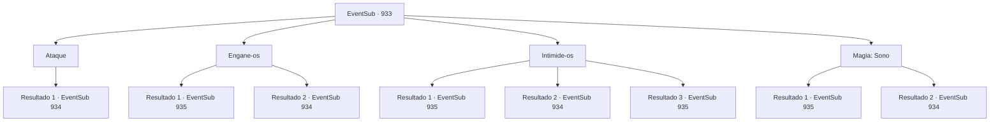

# Eventos secundários · 933

[Índice da tabela](index.md) · [Índice geral](../index.md)

ID: `pt:EventSub:933` · Fonte: `EventSub4` · Versão: 1.2.47.

Mapeamento estático dos arquivos; a disponibilidade e a execução dependem do estado da run.

## Texto do evento

*Sem texto no arquivo.*

## Dados de entrada

```json
{
  "id": 933,
  "grade": 1,
  "subEvent": "",
  "required": ""
}
```

## Mapa das escolhas



## Escolhas e resultados

### Escolha 1

Ataque

Requisitos e outros campos da escolha:

```json
{
  "required": ""
}
```

#### Resultado 1.1

Você os ataca imediatamente. Os soldados respondem habilmente, preparando-se para lutar, prontos com suas lanças.

Continuação registrada: [Evento 934](0934.md) na mesma tabela.

```json
{
  "required": "",
  "chance": "1",
  "nextEvent": 934,
  "type": 2,
  "reward": "6_0_135",
  "place": 6
}
```

### Escolha 2

Engane-os

Requisitos e outros campos da escolha:

```json
{
  "required": ""
}
```

#### Resultado 2.1

Você rapidamente examina o esquema de cores da armadura deles e os reconhece como soldados do Conde Ronan. Você os interroga de forma inversa, com confiança. 

 "O que VOCÊS estão fazendo aqui?"

 Aparentemente, eles não esperavam ser questionados. No entanto, ainda conseguem lhe dar uma resposta. 

 "Ah... hum... Estamos protegendo este lugar, sob as ordens do Bispo Lukas! P- posso perguntar quem é você...?"

 Em vez de respondê-los, você decide deixar sua carisma falar por você. Você faz um gesto para que o deixem em paz. Completamente enganados pela sua atuação, os soldados se apressam para outro lugar. Isso lhe dá tempo para explorar a mina de prata sem ser perturbado.  Você desce mais fundo na mina. Logo, começa a ouvir gemidos - alguém está com dor. 

 "Acho que alguém está chorando... Está vindo dali."

 Antes que você possa detê-la, Erina sai correndo.

Continuação registrada: [Evento 935](0935.md) na mesma tabela.

```json
{
  "required": "",
  "chance": "1|0_12_1",
  "nextEvent": 935,
  "type": 0,
  "reward": ""
}
```

#### Resultado 2.2

Você rapidamente examina o esquema de cores de suas armaduras e os reconhece como soldados do Conde Ronan. Você os interroga ao contrário, com confiança. Mas sua atuação é desajeitada, e eles não acreditam. 

 "Como se fôssemos cair nas suas mentiras!"

 Os soldados avançam contra você, lanças prontas.

Continuação registrada: [Evento 934](0934.md) na mesma tabela.

```json
{
  "required": "",
  "chance": "20",
  "nextEvent": 934,
  "type": 1,
  "reward": "6_3_135",
  "place": 6
}
```

### Escolha 3

Intimide-os

Requisitos e outros campos da escolha:

```json
{
  "required": ""
}
```

#### Resultado 3.1

Você os encara com um olhar mortal silencioso. Funciona maravilhosamente - os soldados, impressionados com sua presença, recuam lentamente. Quando você está prestes a dar mais um passo, eles jogam suas lanças no chão e fogem. Isso lhe dá tempo para explorar a mina de prata minuciosamente e sem ser perturbado.  Você desce mais fundo na mina. Logo, começa a ouvir gemidos - alguém está com dor. 

 "Acho que alguém está chorando... Está vindo dali."

 Antes que você possa detê-la, Erina sai correndo.

Continuação registrada: [Evento 935](0935.md) na mesma tabela.

```json
{
  "required": "21_1_4",
  "chance": "1|0_12_1",
  "nextEvent": 935,
  "type": 0,
  "reward": ""
}
```

#### Resultado 3.2

Você os encara com um olhar mortal silencioso. A única coisa que isso conseguiu foi deixá-los ainda mais irritados. 

 "Que diabos? Onde você aprendeu seus modos, para olhar assim?"

 Eles imediatamente respondem jogando suas lanças em você.

Continuação registrada: [Evento 934](0934.md) na mesma tabela.

```json
{
  "required": "21_1_4",
  "chance": "20",
  "nextEvent": 934,
  "type": 1,
  "reward": "6_3_135",
  "place": 6
}
```

#### Resultado 3.3

Você os encara com um olhar mortal silencioso. Funciona maravilhosamente - os soldados, sobrecarregados pela sua presença, desmaiam. Isso lhe dá tempo para explorar minuciosamente a mina de prata sem ser perturbado.

Continuação registrada: [Evento 935](0935.md) na mesma tabela.

```json
{
  "required": "20_1_4",
  "chance": "1",
  "nextEvent": 935,
  "type": 2,
  "reward": ""
}
```

### Escolha 4

Magia: Sono

Requisitos e outros campos da escolha:

```json
{
  "required": "20_0_1|1_1_2"
}
```

#### Resultado 4.1

Você rapidamente lança um feitiço para colocá-los para dormir.   

 "Ah... Ughhhhh..."

   Os soldados caem em um sono tranquilo.   Isso te deixa com tempo para explorar a mina de prata sem ser perturbado.    Você desce mais fundo na mina.   Logo, você começa a ouvir gemidos - alguém está com dor.   

 "Acho que alguém está chorando... Está vindo dali."

   Antes que você possa detê-la, Erina sai correndo.

Continuação registrada: [Evento 935](0935.md) na mesma tabela.

```json
{
  "required": "",
  "chance": "1|0_7_1|0_12_1",
  "nextEvent": 935,
  "type": 0,
  "reward": "0_1_-1"
}
```

#### Resultado 4.2

Você tenta rapidamente lançar um feitiço para colocá-los para dormir, mas os soldados são mais rápidos. 

 "Ah, você não vai usar truques baratos assim!"

 Os soldados avançam contra você, lanças prontas.

Continuação registrada: [Evento 934](0934.md) na mesma tabela.

```json
{
  "required": "",
  "chance": "30",
  "nextEvent": 934,
  "type": 1,
  "reward": "6_3_135",
  "place": 6
}
```

## Referências que chegam a este evento

- [Evento 932 · escolha 1 · resultado 1](0932.md#escolha-1)
- [Evento 932 · escolha 2 · resultado 1](0932.md#escolha-2)
- [Evento 932 · escolha 2 · resultado 2](0932.md#escolha-2)
